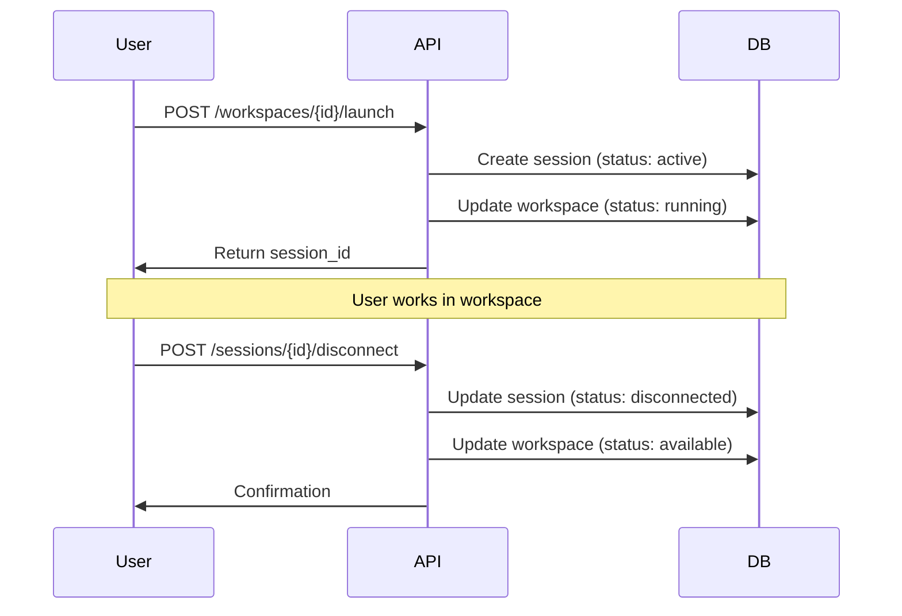

# Sessions API

Sessions represent active or historical connections to workspaces. Each session tracks the user, workspace, connection details, and security status.

## Session Model

<ResponseField name="id" type="string">
  Unique session identifier (UUID v4)
</ResponseField>

<ResponseField name="user_id" type="string">
  ID of the user who created the session
</ResponseField>

<ResponseField name="user_email" type="string">
  Email of the user who created the session
</ResponseField>

<ResponseField name="workspace_id" type="string">
  ID of the workspace being accessed
</ResponseField>

<ResponseField name="workspace_name" type="string">
  Name of the workspace being accessed
</ResponseField>

<ResponseField name="workspace_type" type="string">
  Type of the workspace (e.g., "html5", "rdp", "linux")
</ResponseField>

<ResponseField name="status" type="string">
  Session status: `"active"`, `"disconnected"`, `"terminated"`
</ResponseField>

<ResponseField name="started_at" type="datetime">
  Timestamp when the session started (ISO 8601 format)
</ResponseField>

<ResponseField name="ended_at" type="datetime" nullable>
  Timestamp when the session ended (null if still active)
</ResponseField>

<ResponseField name="ip_address" type="string">
  IP address of the session (defaults to "10.0.0.1")
</ResponseField>

<ResponseField name="tunnel_status" type="string">
  VPN tunnel status (defaults to "encrypted")
</ResponseField>

<ResponseField name="mfa_verified" type="boolean">
  Whether MFA was verified for this session (defaults to true)
</ResponseField>

## List Sessions

Get all sessions for the authenticated user.

```bash
curl https://your-domain.com/api/sessions \
  -H "Authorization: Bearer your-token-here"
```

### Response

```json
[
  {
    "id": "f47ac10b-58cc-4372-a567-0e02b2c3d479",
    "user_id": "a3d2c1b0-9876-4321-abcd-ef1234567890",
    "user_email": "john.doe@acme.com",
    "workspace_id": "ws-sap-neogenesys",
    "workspace_name": "SAP Neogénesys",
    "workspace_type": "html5",
    "status": "active",
    "started_at": "2026-03-05T14:30:00.000Z",
    "ended_at": null,
    "ip_address": "10.0.0.1",
    "tunnel_status": "encrypted",
    "mfa_verified": true
  },
  {
    "id": "b2c3d4e5-6789-4abc-def0-123456789abc",
    "user_id": "a3d2c1b0-9876-4321-abcd-ef1234567890",
    "user_email": "john.doe@acme.com",
    "workspace_id": "ws-linux-desktop",
    "workspace_name": "Linux Desktop",
    "workspace_type": "linux",
    "status": "terminated",
    "started_at": "2026-03-04T09:15:00.000Z",
    "ended_at": "2026-03-04T17:45:00.000Z",
    "ip_address": "10.0.0.1",
    "tunnel_status": "encrypted",
    "mfa_verified": true
  }
]
```

<Note>
  Users can only see their own sessions. The API automatically filters by `user_id`.
</Note>

## List Active Sessions

Get only currently active sessions for the authenticated user.

<CodeGroup>
```bash cURL
curl https://your-domain.com/api/sessions/active \
  -H "Authorization: Bearer your-token-here"
```

```python Python
import requests

response = requests.get(
    "https://your-domain.com/api/sessions/active",
    headers={"Authorization": f"Bearer {token}"}
)

active_sessions = response.json()
print(f"Active sessions: {len(active_sessions)}")

for session in active_sessions:
    print(f"- {session['workspace_name']} (started {session['started_at']})")
```

```javascript JavaScript
const response = await fetch('https://your-domain.com/api/sessions/active', {
  headers: {
    'Authorization': `Bearer ${token}`
  }
});

const sessions = await response.json();
console.log(`Active sessions: ${sessions.length}`);
```
</CodeGroup>

### Response

Returns an array of sessions with `status: "active"`.

```json
[
  {
    "id": "f47ac10b-58cc-4372-a567-0e02b2c3d479",
    "user_id": "a3d2c1b0-9876-4321-abcd-ef1234567890",
    "user_email": "john.doe@acme.com",
    "workspace_id": "ws-sap-neogenesys",
    "workspace_name": "SAP Neogénesys",
    "workspace_type": "html5",
    "status": "active",
    "started_at": "2026-03-05T14:30:00.000Z",
    "ended_at": null,
    "ip_address": "10.0.0.1",
    "tunnel_status": "encrypted",
    "mfa_verified": true
  }
]
```

## Create Session

Sessions are automatically created when launching a workspace. See the [Workspaces API - Launch Workspace](/api/workspaces#launch-workspace) endpoint.

When you call `POST /api/workspaces/{workspace_id}/launch`, the API:

1. Creates a new session with the current user's information
2. Sets the session status to `"active"`
3. Links the session to the workspace
4. Returns the session ID and connection details

## Disconnect Session

Disconnect an active session and mark it as terminated.

<CodeGroup>
```bash cURL
curl -X POST https://your-domain.com/api/sessions/f47ac10b-58cc-4372-a567-0e02b2c3d479/disconnect \
  -H "Authorization: Bearer your-token-here"
```

```python Python
import requests

session_id = "f47ac10b-58cc-4372-a567-0e02b2c3d479"

response = requests.post(
    f"https://your-domain.com/api/sessions/{session_id}/disconnect",
    headers={"Authorization": f"Bearer {token}"}
)

if response.status_code == 200:
    print("Session disconnected successfully")
else:
    print(f"Error: {response.json()['detail']}")
```

```javascript JavaScript
const sessionId = 'f47ac10b-58cc-4372-a567-0e02b2c3d479';

const response = await fetch(
  `https://your-domain.com/api/sessions/${sessionId}/disconnect`,
  {
    method: 'POST',
    headers: {
      'Authorization': `Bearer ${token}`
    }
  }
);

const data = await response.json();
console.log(data.message);
```
</CodeGroup>

### Response

```json
{
  "message": "Session disconnected"
}
```

### Automatic Actions

When a session is disconnected:

1. Session status is updated to `"disconnected"`
2. `ended_at` timestamp is set to current time
3. Associated workspace status is set to `"available"`
4. Audit log entry is created: `"disconnect_session"` action

### Error Responses

<ResponseField name="404" type="error">
  ```json
  {
    "detail": "Session not found"
  }
  ```
  Session doesn't exist or doesn't belong to the authenticated user
</ResponseField>

## Session Status Values

| Status | Description |
|--------|-------------|
| `active` | Session is currently running |
| `disconnected` | Session was manually disconnected |
| `terminated` | Session was stopped (via workspace stop) |

## Session Lifecycle



## Integration with Workspaces

Sessions are tightly integrated with the Workspaces API:

### Creating Sessions

```bash
# Launch workspace (creates session)
curl -X POST https://your-domain.com/api/workspaces/ws-linux-desktop/launch \
  -H "Authorization: Bearer your-token-here"
```

Response includes session information:

```json
{
  "session_id": "f47ac10b-58cc-4372-a567-0e02b2c3d479",
  "workspace": { ... },
  "stream_url": "/viewer/f47ac10b-58cc-4372-a567-0e02b2c3d479",
  "tunnel_status": "encrypted",
  "security": { ... }
}
```

### Stopping Workspaces

```bash
# Stop workspace (terminates session)
curl -X POST https://your-domain.com/api/workspaces/ws-linux-desktop/stop \
  -H "Authorization: Bearer your-token-here"
```

This automatically:
- Finds the active session for that workspace
- Sets session status to `"terminated"`
- Sets session `ended_at` timestamp
- Updates workspace status to `"available"`

## Security Features

All sessions enforce:

<CardGroup cols={2}>
  <Card title="Encrypted Tunnels" icon="lock">
    All sessions use WireGuard VPN via NetBird
  </Card>
  <Card title="MFA Verification" icon="shield-check">
    MFA status is tracked per session
  </Card>
  <Card title="Identity Tracking" icon="user-check">
    User ID and email recorded for audit
  </Card>
  <Card title="Session Recording" icon="video">
    All activity can be recorded for compliance
  </Card>
</CardGroup>

## Example: Monitor Active Sessions

```python
import requests
import time
from datetime import datetime, timezone

BASE_URL = "https://your-domain.com/api"
token = "your-token-here"
headers = {"Authorization": f"Bearer {token}"}

def monitor_sessions():
    """Monitor active sessions every 30 seconds"""
    while True:
        response = requests.get(f"{BASE_URL}/sessions/active", headers=headers)
        sessions = response.json()
        
        print(f"\n[{datetime.now(timezone.utc)}] Active Sessions: {len(sessions)}")
        
        for session in sessions:
            started = datetime.fromisoformat(session['started_at'].replace('Z', '+00:00'))
            duration = datetime.now(timezone.utc) - started
            
            print(f"  - {session['workspace_name']}")
            print(f"    Session ID: {session['id']}")
            print(f"    Duration: {duration}")
            print(f"    Tunnel: {session['tunnel_status']}")
            print(f"    MFA: {'Verified' if session['mfa_verified'] else 'Not verified'}")
        
        time.sleep(30)

if __name__ == "__main__":
    monitor_sessions()
```

## Example: Session Cleanup

```python
import requests
from datetime import datetime, timedelta, timezone

BASE_URL = "https://your-domain.com/api"
token = "your-token-here"
headers = {"Authorization": f"Bearer {token}"}

def cleanup_old_sessions(max_duration_hours=8):
    """Disconnect sessions running longer than max_duration_hours"""
    response = requests.get(f"{BASE_URL}/sessions/active", headers=headers)
    sessions = response.json()
    
    cutoff_time = datetime.now(timezone.utc) - timedelta(hours=max_duration_hours)
    
    for session in sessions:
        started = datetime.fromisoformat(session['started_at'].replace('Z', '+00:00'))
        
        if started < cutoff_time:
            print(f"Disconnecting old session: {session['workspace_name']}")
            requests.post(
                f"{BASE_URL}/sessions/{session['id']}/disconnect",
                headers=headers
            )
            print(f"  Session {session['id']} disconnected")

if __name__ == "__main__":
    cleanup_old_sessions(max_duration_hours=8)
```