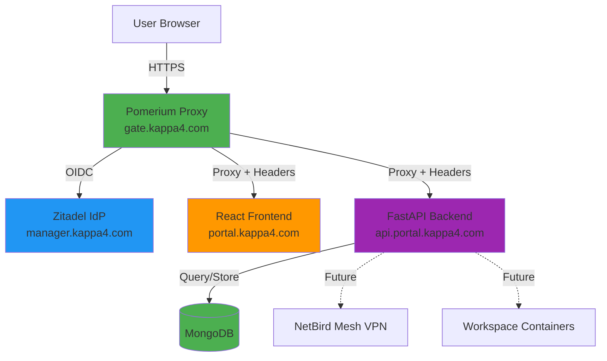
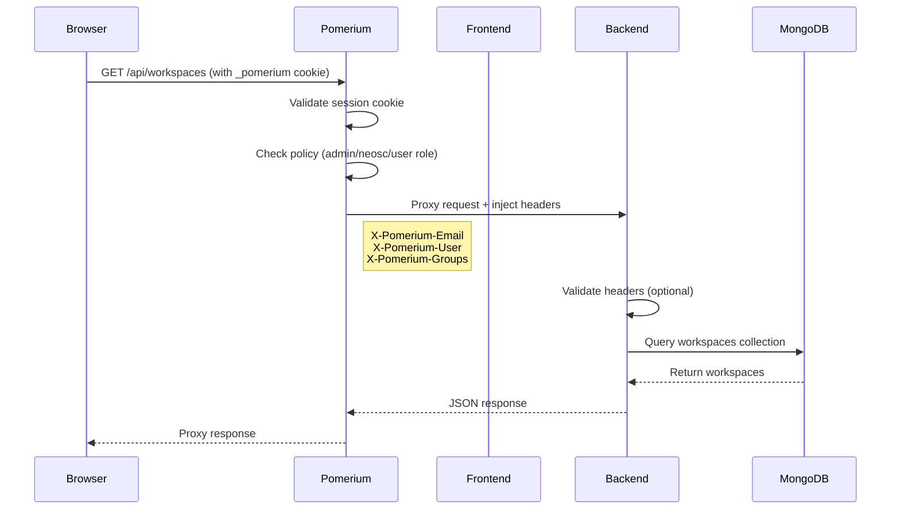
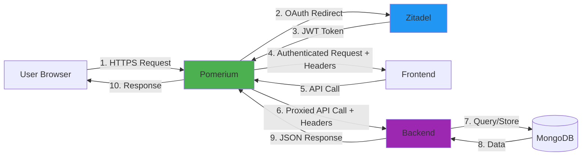

# System Architecture

NeoSC implements a Zero Trust architecture using industry-standard open source components. This guide explains how the system works and how components interact.

## Architecture Overview



## Network Architecture

NeoSC uses a dual-network design following Zero Trust principles:

### Public Network (`proxy`)
- Only Pomerium is exposed to the internet
- Handles SSL/TLS termination
- Routes on ports 80 (redirect) and 443 (HTTPS)

### Internal Network (`internal`)
- Isolated from the internet
- All application services (frontend, backend, MongoDB)
- No direct external access

```yaml docker-compose.yml
networks:
  proxy:
    # Public network: Pomerium ↔ external world
    driver: bridge
  internal:
    # Internal network: services not exposed externally
    driver: bridge
    internal: true
```

<Info>
This design ensures that even if an application service is compromised, it cannot be accessed directly from the internet.
</Info>

## Domain Structure

| Domain | Service | Purpose |
|--------|---------|----------|
| `gate.kappa4.com` | Pomerium Authenticate | OAuth/OIDC flow, session management |
| `portal.kappa4.com` | React Frontend | User interface (SPA) |
| `api.portal.kappa4.com` | FastAPI Backend | REST API, business logic |
| `manager.kappa4.com` | Zitadel | Identity provider, authentication |
| `workspace.portal.kappa4.com` | Future: VDI Streaming | Workspace viewer with WebSocket |
| `admin.portal.kappa4.com` | Future: Admin Panel | Admin-only interfaces |

## Component Deep Dive

### 1. Pomerium - Zero Trust Proxy

**Role:** Single point of entry, enforces authentication and authorization

**Container:** `pomerium/pomerium:latest`

**Configuration:**
```yaml
image: pomerium/pomerium:latest
ports:
  - "443:443"
  - "80:80"
networks:
  - proxy    # External access
  - internal # Internal service communication
environment:
  ZITADEL_CLIENT_ID: ${ZITADEL_CLIENT_ID}
  ZITADEL_CLIENT_SECRET: ${ZITADEL_CLIENT_SECRET}
  POMERIUM_SHARED_SECRET: ${POMERIUM_SHARED_SECRET}
  POMERIUM_COOKIE_SECRET: ${POMERIUM_COOKIE_SECRET}
```

**Key Features:**
- All-in-one mode (authenticate + authorize + proxy)
- OIDC integration with Zitadel
- Context-aware routing based on user identity and roles
- Session cookie (`.kappa4.com`) for SSO across subdomains
- Identity header injection

**Access Policies:**

<CodeGroup>
```yaml Portal Frontend
- from: https://portal.kappa4.com
  to: http://frontend:3000
  allowed_idp_claims:
    urn:zitadel:iam:org:project:roles:
      - admin
      - neosc
      - user
  pass_identity_headers: true
  allow_websockets: true
  preserve_host_header: true
```

```yaml Backend API
- from: https://api.portal.kappa4.com
  to: http://backend:8001
  allowed_idp_claims:
    urn:zitadel:iam:org:project:roles:
      - admin
      - neosc
      - user
  pass_identity_headers: true
  set_request_headers:
    X-Pomerium-Email: "${pomerium.email}"
    X-Pomerium-User: "${pomerium.user}"
    X-Pomerium-Groups: "${pomerium.groups}"
```

```yaml Admin Only Route
- from: https://admin.portal.kappa4.com
  to: http://backend:8001
  allowed_idp_claims:
    urn:zitadel:iam:org:project:roles:
      - admin  # Only admins allowed
  pass_identity_headers: true
```
</CodeGroup>

### 2. Zitadel - Identity Provider

**Role:** Authentication, user management, role-based access control

**Instance:** External (on-premise or cloud)

**OIDC Configuration:**
```yaml
Authority: https://manager.kappa4.com
Project ID: 360327617871609860
Client ID: 360979728544301063
Grant Types:
  - authorization_code
  - refresh_token
Authentication Method: BASIC (client_id + client_secret)
Scopes:
  - openid
  - profile
  - email
  - offline_access
  - urn:zitadel:iam:org:projects:roles
```

**JWT Token Claims:**
```json
{
  "sub": "360845682363341211",
  "email": "user@example.com",
  "name": "John Doe",
  "urn:zitadel:iam:org:project:360327617871609860:roles": {
    "admin": {},
    "neosc": {}
  },
  "groups": ["engineering", "sap-users"]
}
```

<Note>
Zitadel supports multiple authentication methods: password, WebAuthn, TOTP, SMS, and external IdPs (Google, Microsoft, etc.)
</Note>

**Role Definitions:**
- `admin` - Full administrative access (all endpoints, can create/delete workspaces)
- `neosc` - Standard user access (launch workspaces, view sessions)
- `user` - Basic user access (limited workspace access)

### 3. React Frontend

**Role:** User interface for workspace management

**Technology Stack:**
```json package.json
{
  "dependencies": {
    "react": "^19.0.0",
    "react-router-dom": "^7.5.1",
    "react-oidc-context": "^3.3.0",
    "oidc-client-ts": "^3.4.1",
    "axios": "^1.8.4",
    "tailwindcss": "^3.4.17",
    "@radix-ui/react-*": "Various UI components",
    "lucide-react": "^0.507.0"
  }
}
```

**Container Configuration:**
```yaml
frontend:
  build:
    context: ../frontend
    dockerfile: Dockerfile
  container_name: neosc-frontend
  networks:
    - internal  # No external access!
  environment:
    REACT_APP_API_URL: https://api.portal.kappa4.com
    REACT_APP_ZITADEL_AUTHORITY: https://manager.kappa4.com
    REACT_APP_ZITADEL_CLIENT_ID: ${ZITADEL_CLIENT_ID}
    REACT_APP_PORTAL_URL: https://portal.kappa4.com
    REACT_APP_GATE_URL: https://gate.kappa4.com
```

**Key Features:**
- Single Page Application (SPA) with React Router
- OIDC client for SSO (fallback if Pomerium not used)
- shadcn/ui component library for modern UI
- Responsive design with Tailwind CSS
- Real-time session management

### 4. FastAPI Backend

**Role:** Business logic, API endpoints, database operations

**Technology Stack:**
```python backend/server.py
from fastapi import FastAPI, HTTPException, Depends, Header
from motor.motor_asyncio import AsyncIOMotorClient
import httpx  # HTTP client for Zitadel API
from pydantic import BaseModel, Field
```

**Container Configuration:**
```yaml
backend:
  build:
    context: ../backend
    dockerfile: Dockerfile
  container_name: neosc-backend
  networks:
    - internal
  environment:
    MONGO_URL: mongodb://mongo:27017/neosc
    ZITADEL_AUTHORITY: https://manager.kappa4.com
    ZITADEL_CLIENT_ID: ${ZITADEL_CLIENT_ID}
    ZITADEL_CLIENT_SECRET: ${ZITADEL_CLIENT_SECRET}
    TRUST_POMERIUM_HEADERS: "true"
    JWT_SECRET: ${JWT_SECRET}
```

**API Structure:**

<Accordion title="Authentication Endpoints">
```python
# Local authentication (JWT)
POST /api/auth/register
POST /api/auth/login
POST /api/auth/logout

# SSO authentication
POST /api/auth/sso           # Handle Zitadel SSO login
POST /api/auth/token-exchange # Backend-side OIDC token exchange
GET  /api/auth/me            # Get current user info
```
</Accordion>

<Accordion title="Workspace Endpoints">
```python
GET    /api/workspaces              # List all workspaces
POST   /api/workspaces              # Create workspace (admin)
PUT    /api/workspaces/{id}         # Update workspace (admin)
DELETE /api/workspaces/{id}         # Delete workspace (admin)
POST   /api/workspaces/{id}/launch  # Launch workspace
POST   /api/workspaces/{id}/stop    # Stop workspace
POST   /api/workspaces/reset        # Reset to defaults (admin)
```
</Accordion>

<Accordion title="Session Endpoints">
```python
GET  /api/sessions           # List user sessions
GET  /api/sessions/active    # List active sessions
POST /api/sessions/{id}/disconnect  # Disconnect session
```
</Accordion>

<Accordion title="Admin Endpoints">
```python
GET   /api/audit-logs         # View audit logs
GET   /api/policies           # List security policies
PATCH /api/policies/{id}      # Toggle policy
GET   /api/organizations      # List organizations
GET   /api/stats              # System statistics
```
</Accordion>

**Authentication Middleware:**
```python
async def get_current_user(authorization: str = Header(None)):
    """Validate Bearer token from frontend or Pomerium headers"""
    if not authorization or not authorization.startswith("Bearer "):
        raise HTTPException(status_code=401, detail="Not authenticated")
    
    token = authorization.replace("Bearer ", "")
    if token not in active_tokens:
        raise HTTPException(status_code=401, detail="Invalid token")
    
    return active_tokens[token]
```

<Info>
In production with Pomerium, the backend can trust `X-Pomerium-Email` headers instead of validating JWTs, simplifying authentication logic.
</Info>

### 5. MongoDB

**Role:** Persistent storage for users, workspaces, sessions, audit logs

**Container Configuration:**
```yaml
mongo:
  image: mongo:7
  container_name: neosc-mongo
  networks:
    - internal  # Not accessible externally
  volumes:
    - mongo_data:/data/db
  environment:
    MONGO_INITDB_DATABASE: neosc
```

**Collections:**

<CodeGroup>
```json users
{
  "id": "uuid",
  "email": "user@example.com",
  "name": "John Doe",
  "organization": "Acme Corp",
  "role": "admin",
  "mfa_enabled": true,
  "sso_provider": "zitadel",
  "sso_sub": "360845682363341211",
  "created_at": "2026-03-05T10:00:00Z"
}
```

```json workspaces
{
  "id": "ws-sap-neogenesys",
  "name": "SAP Neogénesys",
  "type": "html5",
  "description": "TSPlus HTML5 Desktop for SAP access",
  "url": "http://tsplus.intranet.neosc/",
  "connection_type": "html5",
  "requires_netbird": true,
  "status": "available",
  "cpu": "4 vCPU",
  "memory": "8 GB",
  "storage": "100 GB"
}
```

```json sessions
{
  "id": "session-uuid",
  "user_id": "user-uuid",
  "user_email": "user@example.com",
  "workspace_id": "ws-sap-neogenesys",
  "workspace_name": "SAP Neogénesys",
  "status": "active",
  "started_at": "2026-03-05T10:15:00Z",
  "ended_at": null,
  "ip_address": "10.0.0.1",
  "tunnel_status": "encrypted",
  "mfa_verified": true
}
```

```json audit_logs
{
  "id": "log-uuid",
  "user_id": "user-uuid",
  "user_email": "user@example.com",
  "action": "launch_workspace",
  "resource": "workspace:ws-sap-neogenesys",
  "details": "Launched SAP Neogénesys workspace",
  "ip_address": "192.168.1.100",
  "timestamp": "2026-03-05T10:15:00Z",
  "success": true
}
```
</CodeGroup>

### 6. NetBird - Mesh VPN (Future Integration)

**Role:** Zero Trust network connectivity for workspace access

**Status:** Visual integration in UI, actual connectivity planned for future releases

**Planned Architecture:**
- WireGuard-based encrypted tunnels
- Peer-to-peer mesh networking
- Dynamic access control lists
- OIDC integration with Zitadel
- Browser-based connection (future NetBird Web client)

<Warning>
NetBird integration is currently in planning phase. The UI shows connection status, but actual VPN tunneling is not yet implemented.
</Warning>

## Authentication Flow

Detailed walkthrough of the Zero Trust authentication process:

<Steps>
  <Step title="User Accesses Portal">
    User navigates to `https://portal.kappa4.com`
    
    ```bash
    GET https://portal.kappa4.com
    ```
  </Step>
  
  <Step title="Pomerium Intercepts">
    Pomerium checks for valid session cookie (`_pomerium`)
    
    No cookie found → Redirect to authenticate service
    
    ```bash
    302 Found
    Location: https://gate.kappa4.com/oauth2/sign_in
    ```
  </Step>
  
  <Step title="Redirect to Zitadel">
    Pomerium redirects to Zitadel OIDC authorize endpoint
    
    ```bash
    302 Found
    Location: https://manager.kappa4.com/oauth/v2/authorize?
      client_id=360979728544301063&
      redirect_uri=https://gate.kappa4.com/oauth2/callback&
      response_type=code&
      scope=openid+profile+email&
      state=random-state
    ```
  </Step>
  
  <Step title="User Authenticates">
    User enters credentials in Zitadel (email/password, WebAuthn, TOTP, etc.)
    
    Zitadel validates credentials and enforces MFA if configured
  </Step>
  
  <Step title="Authorization Code Returned">
    Zitadel redirects back to Pomerium with authorization code
    
    ```bash
    302 Found
    Location: https://gate.kappa4.com/oauth2/callback?
      code=authorization-code&
      state=random-state
    ```
  </Step>
  
  <Step title="Token Exchange">
    Pomerium exchanges authorization code for tokens
    
    ```bash
    POST https://manager.kappa4.com/oauth/v2/token
    Content-Type: application/x-www-form-urlencoded
    
    grant_type=authorization_code&
    client_id=360979728544301063&
    client_secret=secret&
    code=authorization-code&
    redirect_uri=https://gate.kappa4.com/oauth2/callback
    ```
    
    Response:
    ```json
    {
      "access_token": "eyJhbGc...",
      "id_token": "eyJhbGc...",
      "refresh_token": "refresh-token",
      "expires_in": 28800
    }
    ```
  </Step>
  
  <Step title="Session Creation">
    Pomerium:
    1. Validates ID token signature
    2. Extracts user identity and roles
    3. Checks role against policy (`admin`, `neosc`, or `user`)
    4. Creates session cookie (`_pomerium`)
    5. Sets cookie domain to `.kappa4.com` (SSO across subdomains)
  </Step>
  
  <Step title="Redirect to Portal">
    Pomerium redirects back to original destination
    
    ```bash
    302 Found
    Location: https://portal.kappa4.com
    Set-Cookie: _pomerium=encrypted-session-data;
                Domain=.kappa4.com;
                Secure;
                HttpOnly;
                SameSite=Lax;
                Max-Age=28800
    ```
  </Step>
  
  <Step title="Access Granted">
    User accesses portal with valid session cookie
    
    Pomerium proxies request to frontend, injecting identity headers:
    
    ```bash
    GET http://frontend:3000/
    X-Pomerium-Email: user@example.com
    X-Pomerium-User: 360845682363341211
    X-Pomerium-Groups: admin,neosc
    ```
  </Step>
</Steps>

## API Request Flow

How API requests are authenticated and authorized:



## Security Model

NeoSC implements defense-in-depth security:

### Layer 1: Network Isolation
- Only Pomerium exposed to internet
- Internal services on isolated Docker network
- No direct access to backend/database

### Layer 2: Identity Verification
- Every request authenticated via Zitadel OIDC
- MFA enforcement configurable per-user
- Short-lived access tokens (8 hours)
- Refresh tokens for seamless re-authentication

### Layer 3: Authorization
- Role-based access control (RBAC)
- Granular policies per route/subdomain
- Context-aware decisions (user, role, time, IP)

### Layer 4: Encryption
- TLS 1.3 for all external traffic
- Encrypted session cookies (HttpOnly, Secure)
- Future: WireGuard tunnels for workspace access

### Layer 5: Audit & Compliance
- Complete audit log of all actions
- Immutable logs in MongoDB
- Audit includes: user, action, resource, timestamp, IP, result
- Session recording (planned feature)

## Data Flow Diagram



## Deployment Topologies

<Tabs>
  <Tab title="Single Server">
    **All-in-one deployment** (development/small production)
    
    ```
    [Server]
    ├── Pomerium (ports 80/443)
    ├── Frontend (internal)
    ├── Backend (internal)
    └── MongoDB (internal)
    ```
    
    **Pros:** Simple, low cost
    **Cons:** Single point of failure, limited scale
  </Tab>
  
  <Tab title="Multi-Server">
    **Distributed deployment** (production)
    
    ```
    [Load Balancer]
    ├── [Server 1] Pomerium
    ├── [Server 2] Pomerium
    ├── [Server 3] Frontend + Backend
    ├── [Server 4] Frontend + Backend
    └── [Server 5] MongoDB Replica Set
    ```
    
    **Pros:** High availability, horizontal scaling
    **Cons:** More complex, higher cost
  </Tab>
  
  <Tab title="Hybrid Cloud">
    **On-premise + cloud** (enterprise)
    
    ```
    [On-Premise]
    ├── Zitadel (manager.kappa4.com)
    ├── NetBird Management
    └── Internal services (SAP, etc.)
    
    [Cloud (GCP/AWS)]
    ├── Pomerium
    ├── Frontend
    ├── Backend
    └── MongoDB
    ```
    
    **Pros:** Keep sensitive IdP on-premise, scale app in cloud
    **Cons:** Network latency, VPN/interconnect required
  </Tab>
</Tabs>

## Performance Considerations

### Latency Targets
- Pomerium authentication: < 100ms
- API response time: < 200ms
- Workspace provisioning: < 25s (future)
- Database queries: < 50ms

### Scaling Limits
- Single server: ~100 concurrent users
- Multi-server: 1000+ concurrent users
- Database: Sharding for >10M documents

### Bottlenecks & Mitigations

| Component | Bottleneck | Mitigation |
|-----------|------------|------------|
| Pomerium | Token validation | Enable caching, use Redis |
| Backend | Database queries | Add indexes, use connection pooling |
| MongoDB | Write throughput | Replica set, sharding |
| Frontend | Bundle size | Code splitting, lazy loading |

## Monitoring & Observability

Recommended monitoring stack (future implementation):

- **Metrics:** Prometheus + Grafana
- **Logs:** ELK Stack or Loki
- **Tracing:** Jaeger or Zipkin
- **Alerting:** Prometheus Alertmanager + PagerDuty

**Key Metrics to Monitor:**
```yaml
# Pomerium
- pomerium_requests_total
- pomerium_request_duration_seconds
- pomerium_session_cache_hits

# Backend
- http_requests_total
- http_request_duration_seconds
- workspace_launches_total
- workspace_launch_duration_seconds

# MongoDB
- mongodb_connections_current
- mongodb_operations_total
- mongodb_query_latency_seconds
```

## Next Steps

<CardGroup cols={2}>
  <Card title="User Management" icon="users" href="/guides/user-management">
    Learn how to manage users, roles, and permissions
  </Card>
  
  <Card title="Workspace Configuration" icon="desktop" href="/guides/workspace-configuration">
    Configure and customize workspace environments
  </Card>
  
  <Card title="Security Policies" icon="shield" href="/features/security-policies">
    Configure MFA, session recording, and access policies
  </Card>
  
  <Card title="Monitoring Setup" icon="chart-line" href="/guides/monitoring">
    Set up monitoring and alerting for production
  </Card>
</CardGroup>