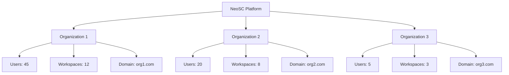

## Overview

Organizations provide multi-tenant isolation in NeoSC, allowing you to separate users, workspaces, and resources by organizational boundaries. Each organization has its own domain, user pool, and workspace allocation.

## Organization Model

The organization object tracks key metrics and configuration:

```python backend/server.py:105
class Organization(BaseModel):
    id: str                    # Unique organization identifier
    name: str                  # Organization display name
    domain: str                # Organization domain (e.g., "neogenesys.com")
    users_count: int = 0       # Number of users in the organization
    workspaces_count: int = 0  # Number of assigned workspaces
    created_at: datetime       # Organization creation timestamp
```

## Use Cases

<CardGroup cols={2}>
  <Card title="Enterprise Departments" icon="building">
    Separate IT, Finance, and HR departments with isolated workspaces and users
  </Card>
  <Card title="Multi-Customer SaaS" icon="users">
    Provide each customer with their own isolated environment
  </Card>
  <Card title="Development Environments" icon="code">
    Isolate dev, staging, and production teams
  </Card>
  <Card title="Partner Access" icon="handshake">
    Grant external partners access to specific workspaces
  </Card>
</CardGroup>

## Listing Organizations

Retrieve all organizations accessible to the authenticated user:

<CodeGroup>
```bash cURL
curl -X GET "https://api.neosc.com/api/organizations" \
  -H "Authorization: Bearer YOUR_TOKEN"
```

```javascript JavaScript
const response = await axios.get(`${API}/organizations`, {
  headers: { Authorization: `Bearer ${token}` }
});

const organizations = response.data;
```

```python Python
response = requests.get(
    "https://api.neosc.com/api/organizations",
    headers={"Authorization": f"Bearer {token}"}
)

organizations = response.json()
```
</CodeGroup>

### Response Example

```json
[
  {
    "id": "org-550e8400-e29b-41d4",
    "name": "Neogenesys",
    "domain": "neogenesys.com",
    "users_count": 45,
    "workspaces_count": 12,
    "created_at": "2026-01-15T10:00:00Z"
  },
  {
    "id": "org-660f9511-f39c-52e5",
    "name": "Partner Corp",
    "domain": "partnercorp.com",
    "users_count": 8,
    "workspaces_count": 3,
    "created_at": "2026-02-20T14:30:00Z"
  }
]
```

## Default Organization

When a user registers without specifying an organization, they're assigned to a default organization:

```python backend/server.py:747
@api_router.get("/organizations")
async def get_organizations(user: dict = Depends(get_current_user)):
    orgs = await db.organizations.find({}, {"_id": 0}).to_list(100)
    
    if not orgs:
        # Create default organization
        default_org = Organization(
            name=user.get('organization', 'Default Organization'),
            domain="neogenesys.com",
            users_count=1,
            workspaces_count=5
        )
        await db.organizations.insert_one(default_org.model_dump())
        orgs = [default_org.model_dump()]
    
    return orgs
```

## User Registration with Organization

Assign users to organizations during registration:

```python backend/server.py:147
@api_router.post("/auth/register")
async def register(user_data: UserCreate):
    user = User(
        email=user_data.email,
        name=user_data.name,
        organization=user_data.organization or "Default Organization"
    )
    # ... create user
```

<CodeGroup>
```bash Register with Organization
curl -X POST "https://api.neosc.com/api/auth/register" \
  -H "Content-Type: application/json" \
  -d '{
    "email": "user@neogenesys.com",
    "password": "secure_password",
    "name": "John Doe",
    "organization": "Neogenesys"
  }'
```

```javascript JavaScript
const userData = {
  email: "user@neogenesys.com",
  password: "secure_password",
  name: "John Doe",
  organization: "Neogenesys"
};

const response = await axios.post(`${API}/auth/register`, userData);
```
</CodeGroup>

## SSO Organization Mapping

When using Zitadel SSO, organizations are automatically extracted from the OIDC profile:

```python backend/server.py:228
@api_router.post("/auth/sso")
async def sso_login(sso_data: SSOLoginRequest):
    profile = sso_data.profile
    
    # Create new user from SSO
    user = User(
        email=email,
        name=name,
        organization=profile.get('org') or 
                     profile.get('urn:zitadel:iam:org:id') or 
                     'Zitadel SSO',
        role=user_role,
        mfa_enabled=True
    )
```

<Info>
Zitadel organizations are mapped using the `org` claim or `urn:zitadel:iam:org:id` from the OIDC token.
</Info>

## Organization UI Display

The frontend displays organizations with metrics and visual cards:

```jsx frontend/src/pages/OrganizationsPage.jsx:68
<div className="grid gap-6 md:grid-cols-2 lg:grid-cols-3">
  {organizations.map((org) => (
    <div key={org.id} className="p-6 rounded-xl bg-card border">
      <div className="flex items-center gap-4 mb-4">
        <div className="w-14 h-14 rounded-xl bg-gradient-to-br from-cyan-500/20 to-orange-500/20">
          <Building2 className="w-7 h-7 text-primary" />
        </div>
        <div>
          <h3 className="text-lg font-semibold">{org.name}</h3>
          <div className="flex items-center gap-1.5 text-sm text-muted-foreground">
            <Globe className="w-3.5 h-3.5" />
            {org.domain}
          </div>
        </div>
      </div>

      <div className="grid grid-cols-2 gap-4 pt-4 border-t">
        <div className="flex items-center gap-2">
          <Users className="w-4 h-4" />
          <span className="font-medium">{org.users_count}</span>
          <span className="text-sm">Users</span>
        </div>
        <div className="flex items-center gap-2">
          <Monitor className="w-4 h-4" />
          <span className="font-medium">{org.workspaces_count}</span>
          <span className="text-sm">Workspaces</span>
        </div>
      </div>
    </div>
  ))}
</div>
```

## User-Organization Relationship

Each user belongs to exactly one organization:

```python backend/server.py:41
class User(BaseModel):
    id: str
    email: str
    name: str
    organization: str = "Default Organization"  # Organization name
    role: str = "user"
    mfa_enabled: bool = True
    created_at: datetime
```

## Workspace Isolation

While the current implementation shares workspaces globally, you can implement organization-specific workspace filtering:

```python Workspace Filtering Example
@api_router.get("/workspaces")
async def get_workspaces(user: dict = Depends(get_current_user)):
    # Filter workspaces by organization
    workspaces = await db.workspaces.find(
        {"organization": user['organization']},
        {"_id": 0}
    ).to_list(100)
    return workspaces
```

## Creating Organizations (Future)

Organization creation will be available for admin users:

```jsx frontend/src/pages/OrganizationsPage.jsx:46
<Button 
  className="bg-primary hover:bg-primary/90"
  disabled
>
  <Plus className="w-4 h-4 mr-2" />
  New Organization
</Button>
```

<Note>
Organizations are automatically created during user registration and SSO login. Manual organization creation through the UI is not currently available.
</Note>

## Audit Trail

All organization-related activities are tracked in audit logs:

```python Example Audit Events
- "create_organization" - New organization created
- "update_organization" - Organization settings changed
- "add_user_to_org" - User added to organization
- "remove_user_from_org" - User removed from organization
```

## Multi-Tenancy Architecture



## Domain-Based Access

Organizations use domain-based identification:

```javascript Example: Domain Validation
const userEmail = "john@neogenesys.com";
const domain = userEmail.split('@')[1];  // "neogenesys.com"

// Find matching organization
const org = organizations.find(o => o.domain === domain);
```

## Best Practices

<AccordionGroup>
  <Accordion title="Organization Design">
    - Use meaningful organization names that reflect business structure
    - Map domains to corporate email domains for SSO integration
    - Keep organization structure flat to avoid complexity
    - Plan for growth by reserving workspace capacity
  </Accordion>
  
  <Accordion title="User Management">
    - Assign users to organizations during onboarding
    - Use SSO organization claims for automatic assignment
    - Monitor user_count metrics for license compliance
    - Implement organization-level admin roles
  </Accordion>
  
  <Accordion title="Resource Allocation">
    - Allocate workspaces based on organization size
    - Set workspace quotas per organization
    - Monitor workspace_count for capacity planning
    - Implement billing based on organization metrics
  </Accordion>
  
  <Accordion title="Security">
    - Enforce organization boundaries in all API endpoints
    - Validate user organization membership before access
    - Audit cross-organization access attempts
    - Implement organization-specific security policies
  </Accordion>
</AccordionGroup>

## Metrics and Reporting

### User Count

Track the number of users per organization:

```python Calculate Users Count
users_count = await db.users.count_documents(
    {"organization": org_name}
)
```

### Workspace Count

Monitor workspace allocation:

```python Calculate Workspaces Count
workspaces_count = await db.workspaces.count_documents(
    {"organization": org_name}
)
```

## Future Enhancements

<CardGroup cols={2}>
  <Card title="Custom Branding" icon="palette">
    Organization-specific logos, colors, and themes
  </Card>
  <Card title="Resource Quotas" icon="gauge">
    Set CPU, memory, and storage limits per organization
  </Card>
  <Card title="Billing Integration" icon="credit-card">
    Per-organization usage tracking and billing
  </Card>
  <Card title="Organization Admin" icon="user-shield">
    Dedicated admin role for organization management
  </Card>
</CardGroup>

## Related Resources

<CardGroup cols={2}>
  <Card title="Users & Authentication" icon="user" href="/api/authentication">
    User registration and SSO integration
  </Card>
  <Card title="Workspaces" icon="desktop" href="/features/workspaces">
    Workspace allocation and management
  </Card>
  <Card title="Security Policies" icon="shield" href="/features/security-policies">
    Organization-level security configuration
  </Card>
  <Card title="Audit Logs" icon="list" href="/features/audit-logs">
    Track organization activities
  </Card>
</CardGroup>