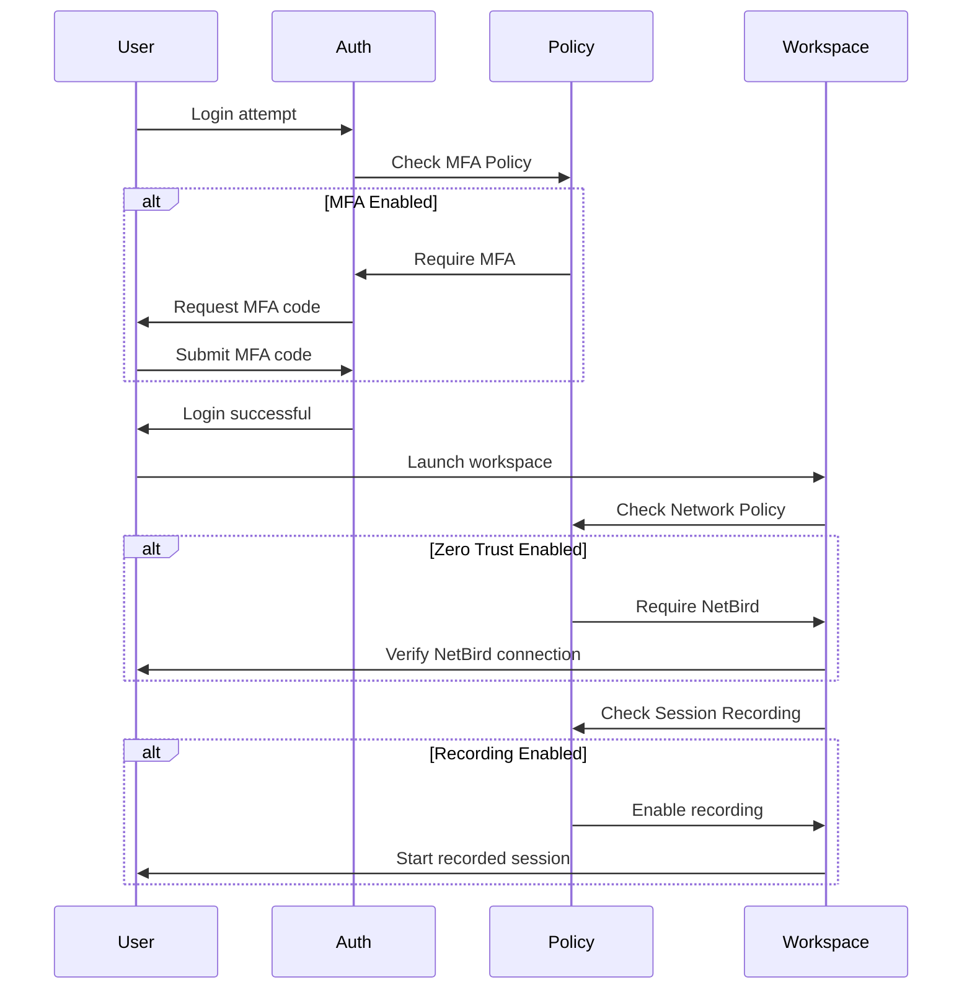

## Overview

Security policies in NeoSC enforce Zero Trust principles across your infrastructure. Policies control access requirements, network security, and session monitoring to ensure compliance and data protection.

## Policy Model

Each security policy contains rules and enablement status:

```python backend/server.py:114
class Policy(BaseModel):
    id: str                    # Unique policy identifier
    name: str                  # Policy display name
    description: str           # Policy description
    type: str                  # access, network, session
    rules: List[str]          # List of policy rules
    enabled: bool = True       # Policy activation status
    created_at: datetime       # Policy creation timestamp
```

## Policy Types

NeoSC supports three categories of security policies:

<Tabs>
  <Tab title="Access Policies">
    Control authentication and authorization requirements.
    
    **Examples:**
    - Multi-Factor Authentication (MFA)
    - WebAuthn/FIDO2 enforcement
    - Password complexity rules
    - Session timeout settings
  </Tab>
  
  <Tab title="Network Policies">
    Define network security and connectivity rules.
    
    **Examples:**
    - Zero Trust networking
    - Encrypted tunnel requirements
    - IP whitelisting/blacklisting
    - VPN/NetBird requirements
  </Tab>
  
  <Tab title="Session Policies">
    Manage session behavior and monitoring.
    
    **Examples:**
    - Session recording
    - Idle timeout
    - Concurrent session limits
    - Activity logging
  </Tab>
</Tabs>

## Default Policies

NeoSC comes with three pre-configured security policies:

```python backend/server.py:767
DEFAULT_POLICIES = [
    {
        "id": "pol-mfa-required",
        "name": "MFA Required",
        "description": "Enforce multi-factor authentication for all users",
        "type": "access",
        "rules": [
            "Require MFA for login",
            "WebAuthn preferred",
            "TOTP as fallback"
        ],
        "enabled": True
    },
    {
        "id": "pol-network-zero-trust",
        "name": "Zero Trust Network",
        "description": "All connections through encrypted NetBird tunnels",
        "type": "network",
        "rules": [
            "No direct connections",
            "WireGuard encryption",
            "Identity verification"
        ],
        "enabled": True
    },
    {
        "id": "pol-session-recording",
        "name": "Session Recording",
        "description": "Record all workspace sessions for audit",
        "type": "session",
        "rules": [
            "Record screen activity",
            "Log keystrokes for audit",
            "30-day retention"
        ],
        "enabled": True
    }
]
```

## Listing Policies

Retrieve all security policies:

<CodeGroup>
```bash cURL
curl -X GET "https://api.neosc.com/api/policies" \
  -H "Authorization: Bearer YOUR_TOKEN"
```

```javascript JavaScript
const response = await axios.get(`${API}/policies`, {
  headers: { Authorization: `Bearer ${token}` }
});

const policies = response.data;
```

```python Python
response = requests.get(
    "https://api.neosc.com/api/policies",
    headers={"Authorization": f"Bearer {token}"}
)

policies = response.json()
```
</CodeGroup>

### Response Example

```json
[
  {
    "id": "pol-mfa-required",
    "name": "MFA Required",
    "description": "Enforce multi-factor authentication for all users",
    "type": "access",
    "rules": [
      "Require MFA for login",
      "WebAuthn preferred",
      "TOTP as fallback"
    ],
    "enabled": true,
    "created_at": "2026-01-15T10:00:00Z"
  }
]
```

## Toggling Policies

Enable or disable a policy:

```bash backend/server.py:806
PATCH /api/policies/{policy_id}
```

<CodeGroup>
```javascript JavaScript
const handleTogglePolicy = async (policyId) => {
  const response = await axios.patch(
    `${API}/policies/${policyId}`,
    {},
    { headers: getAuthHeader() }
  );
  
  toast.success(response.data.message);
};
```

```bash cURL
curl -X PATCH "https://api.neosc.com/api/policies/pol-mfa-required" \
  -H "Authorization: Bearer YOUR_TOKEN"
```

```json Response
{
  "message": "Policy enabled",
  "enabled": true
}
```
</CodeGroup>

<Warning>
Toggling critical security policies like MFA or Zero Trust networking can impact system security. Ensure you understand the implications before disabling policies.
</Warning>

## MFA Policy

### Overview

The MFA Required policy enforces multi-factor authentication for all user logins.

### Configuration

```json
{
  "id": "pol-mfa-required",
  "name": "MFA Required",
  "type": "access",
  "rules": [
    "Require MFA for login",
    "WebAuthn preferred",
    "TOTP as fallback"
  ],
  "enabled": true
}
```

### Implementation

MFA status is tracked per user:

```python backend/server.py:48
class User(BaseModel):
    mfa_enabled: bool = True  # MFA enforcement flag
```

Sessions inherit MFA verification:

```python backend/server.py:91
class Session(BaseModel):
    mfa_verified: bool = True  # MFA verification status
```

### Effects When Enabled

<Steps>
  <Step title="Login Enforcement">
    Users must complete MFA during authentication
  </Step>
  <Step title="Session Verification">
    All sessions are marked with `mfa_verified: true`
  </Step>
  <Step title="UI Indicators">
    MFA badges appear in session and workspace views
  </Step>
</Steps>

## Zero Trust Network Policy

### Overview

Enforces all connections through encrypted NetBird WireGuard tunnels with no direct internet access to workspaces.

### Configuration

```json
{
  "id": "pol-network-zero-trust",
  "name": "Zero Trust Network",
  "type": "network",
  "rules": [
    "No direct connections",
    "WireGuard encryption",
    "Identity verification"
  ],
  "enabled": true
}
```

### NetBird Integration

Workspaces require active NetBird connection:

```python backend/server.py:458
{
    "requires_netbird": True,  # NetBird VPN requirement flag
}
```

### Security Features

<CardGroup cols={2}>
  <Card title="Encrypted Tunnels" icon="lock">
    All traffic flows through WireGuard VPN tunnels
  </Card>
  <Card title="No Open Ports" icon="shield">
    Workspaces have no publicly exposed ports
  </Card>
  <Card title="Identity Verification" icon="fingerprint">
    NetBird verifies device and user identity
  </Card>
  <Card title="Zero Trust" icon="shield-check">
    Never trust, always verify approach
  </Card>
</CardGroup>

### Workspace Launch Security

```python backend/server.py:648
return {
    "session_id": session.id,
    "workspace": workspace,
    "stream_url": f"/viewer/{session.id}",
    "tunnel_status": "encrypted",
    "security": {
        "encrypted_tunnel": True,
        "identity_verified": True,
        "mfa_enforced": user.get('mfa_enabled', True),
        "session_recording": True,
        "no_open_ports": True
    }
}
```

## Session Recording Policy

### Overview

Records all workspace activity for audit compliance and security monitoring.

### Configuration

```json
{
  "id": "pol-session-recording",
  "name": "Session Recording",
  "type": "session",
  "rules": [
    "Record screen activity",
    "Log keystrokes for audit",
    "30-day retention"
  ],
  "enabled": true
}
```

### What Gets Recorded

<AccordionGroup>
  <Accordion title="Screen Activity">
    Full screen recording of workspace sessions at 30 FPS
  </Accordion>
  
  <Accordion title="Keystroke Logging">
    Command and keystroke audit trail (not passwords)
  </Accordion>
  
  <Accordion title="Network Activity">
    Connections, data transfers, and access patterns
  </Accordion>
  
  <Accordion title="Session Metadata">
    User, workspace, duration, IP address, timestamps
  </Accordion>
</AccordionGroup>

### Retention Policy

Session recordings are retained for 30 days:

```python Retention Logic
# Recordings older than 30 days are automatically deleted
retention_days = 30
cutoff_date = datetime.now(timezone.utc) - timedelta(days=retention_days)

await db.session_recordings.delete_many(
    {"created_at": {"$lt": cutoff_date}}
)
```

<Info>
Session recording data is encrypted at rest and in transit. Access is logged in audit trails.
</Info>

## Policy UI Implementation

The frontend provides an intuitive interface for managing policies:

```jsx frontend/src/pages/PoliciesPage.jsx:80
<div className="grid gap-6">
  {policies.map((policy) => {
    const Icon = policyIcons[policy.type] || Shield;
    const iconColor = policyColors[policy.type];
    
    return (
      <div className="p-6 rounded-xl bg-card border">
        <div className="flex items-start justify-between">
          <div className="flex items-start gap-4">
            <div className="w-12 h-12 rounded-lg bg-muted/50">
              <Icon className={`w-6 h-6 ${iconColor}`} />
            </div>
            <div>
              <h3 className="text-lg font-semibold">{policy.name}</h3>
              <Badge variant="outline" className="capitalize text-xs">
                {policy.type}
              </Badge>
              <p className="text-muted-foreground">{policy.description}</p>
              
              {/* Rules */}
              <ul className="space-y-1">
                {policy.rules?.map((rule, index) => (
                  <li key={index} className="flex items-center gap-2">
                    <span className="w-1.5 h-1.5 rounded-full bg-primary" />
                    {rule}
                  </li>
                ))}
              </ul>
            </div>
          </div>

          <div className="flex items-center gap-3">
            <span className={policy.enabled ? 'text-green-400' : 'text-muted'}>
              {policy.enabled ? 'Enabled' : 'Disabled'}
            </span>
            <Switch
              checked={policy.enabled}
              onCheckedChange={() => handleTogglePolicy(policy.id)}
            />
          </div>
        </div>
      </div>
    );
  })}
</div>
```

## Audit Trail

All policy changes are tracked in audit logs:

```python backend/server.py:814
await create_audit_log(
    user['id'], 
    user['email'], 
    "toggle_policy",
    f"policy:{policy_id}", 
    f"Policy {'enabled' if new_status else 'disabled'}"
)
```

### Example Audit Events

```json
[
  {
    "user_email": "admin@neogenesys.com",
    "action": "toggle_policy",
    "resource": "policy:pol-mfa-required",
    "details": "Policy disabled",
    "timestamp": "2026-03-05T14:30:00Z",
    "success": true
  }
]
```

## Creating Custom Policies (Future)

Custom policy creation will be available for advanced users:

```javascript Policy Creation Example
const newPolicy = {
  name: "Geo-Restriction Policy",
  description: "Block access from specific countries",
  type: "network",
  rules: [
    "Block IPs from sanctioned countries",
    "Allow EU and US only",
    "Log all blocked attempts"
  ],
  enabled: true
};

await axios.post(`${API}/policies`, newPolicy, {
  headers: getAuthHeader()
});
```

<Note>
Custom policy creation is planned for future releases. Currently, only default policies can be toggled.
</Note>

## Policy Enforcement Flow



## Best Practices

<AccordionGroup>
  <Accordion title="Access Policies">
    - Always enable MFA for production environments
    - Support multiple MFA methods (WebAuthn, TOTP)
    - Implement password complexity requirements
    - Set appropriate session timeout values
  </Accordion>
  
  <Accordion title="Network Policies">
    - Enable Zero Trust networking for all environments
    - Require NetBird for internal resources
    - Implement IP allowlisting for admin access
    - Monitor and log all connection attempts
  </Accordion>
  
  <Accordion title="Session Policies">
    - Enable session recording for compliance requirements
    - Configure appropriate retention periods
    - Encrypt recorded sessions at rest
    - Limit concurrent sessions per user
  </Accordion>
  
  <Accordion title="Policy Management">
    - Review policies quarterly
    - Test policy changes in staging first
    - Document policy rationale and exceptions
    - Audit policy changes regularly
  </Accordion>
</AccordionGroup>

## Compliance Considerations

### SOC 2

- Session recording provides audit trail
- MFA enforces access controls
- Zero Trust networking ensures data protection

### GDPR

- Session recordings include personal data
- 30-day retention supports right to erasure
- Audit logs track data access

### ISO 27001

- Policies enforce information security controls
- Network segmentation via Zero Trust
- Access control through MFA

## Related Resources

<CardGroup cols={2}>
  <Card title="Audit Logs" icon="list" href="/features/audit-logs">
    Track policy changes and enforcement
  </Card>
  <Card title="Sessions" icon="clock" href="/features/sessions">
    Session recording and monitoring
  </Card>
  <Card title="Authentication" icon="key" href="/api/authentication">
    MFA and SSO configuration
  </Card>
  <Card title="Organizations" icon="building" href="/features/organizations">
    Organization-level policy management
  </Card>
</CardGroup>