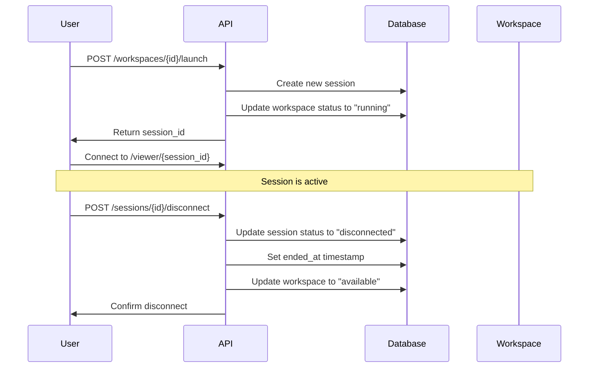

## Overview

Sessions represent active connections between users and workspaces. Each session tracks connection status, security metrics, duration, and provides real-time monitoring capabilities.

## Session Model

The session object contains comprehensive tracking information:

```python backend/server.py:78
class Session(BaseModel):
    id: str                    # Unique session identifier
    user_id: str              # User who created the session
    user_email: str           # User email address
    workspace_id: str         # Connected workspace ID
    workspace_name: str       # Workspace display name
    workspace_type: str       # Workspace type (linux, windows, etc.)
    status: str               # active, disconnected, terminated
    started_at: datetime      # Session start timestamp
    ended_at: Optional[datetime]  # Session end timestamp (if ended)
    ip_address: str           # User's IP address
    tunnel_status: str        # encrypted, disconnected
    mfa_verified: bool        # MFA verification status
```

## Session Status

Sessions can have three distinct states:

<Tabs>
  <Tab title="Active">
    The session is currently running and the user can connect to the workspace.
    
    ```json
    {
      "status": "active",
      "tunnel_status": "encrypted",
      "ended_at": null
    }
    ```
  </Tab>
  
  <Tab title="Disconnected">
    The session was interrupted but can potentially be reconnected.
    
    ```json
    {
      "status": "disconnected",
      "tunnel_status": "disconnected",
      "ended_at": "2026-03-05T14:30:00Z"
    }
    ```
  </Tab>
  
  <Tab title="Terminated">
    The session has been permanently closed and cannot be reconnected.
    
    ```json
    {
      "status": "terminated",
      "ended_at": "2026-03-05T14:30:00Z"
    }
    ```
  </Tab>
</Tabs>

## Listing All Sessions

Retrieve all sessions for the authenticated user:

<CodeGroup>
```bash cURL
curl -X GET "https://api.neosc.com/api/sessions" \
  -H "Authorization: Bearer YOUR_TOKEN"
```

```javascript JavaScript
const response = await axios.get(`${API}/sessions`, {
  headers: { Authorization: `Bearer ${token}` }
});

const sessions = response.data;
```

```python Python
response = requests.get(
    "https://api.neosc.com/api/sessions",
    headers={"Authorization": f"Bearer {token}"}
)

sessions = response.json()
```
</CodeGroup>

### Response Example

```json
[
  {
    "id": "550e8400-e29b-41d4-a716-446655440000",
    "user_id": "user-123",
    "user_email": "user@example.com",
    "workspace_id": "ws-sap-neogenesys",
    "workspace_name": "SAP Neogénesys",
    "workspace_type": "html5",
    "status": "active",
    "started_at": "2026-03-05T14:00:00Z",
    "ended_at": null,
    "ip_address": "10.0.0.1",
    "tunnel_status": "encrypted",
    "mfa_verified": true
  }
]
```

## Getting Active Sessions

Retrieve only currently active sessions:

```bash backend/server.py:692
GET /api/sessions/active
```

<CodeGroup>
```javascript JavaScript
const response = await axios.get(`${API}/sessions/active`, {
  headers: getAuthHeader()
});

const activeSessions = response.data;
```

```bash cURL
curl -X GET "https://api.neosc.com/api/sessions/active" \
  -H "Authorization: Bearer YOUR_TOKEN"
```
</CodeGroup>

## Session Creation

Sessions are automatically created when launching a workspace:

```python backend/server.py:619
@api_router.post("/workspaces/{workspace_id}/launch")
async def launch_workspace(workspace_id: str, user: dict = Depends(get_current_user)):
    # Create a new session
    session = Session(
        user_id=user['id'],
        user_email=user['email'],
        workspace_id=workspace_id,
        workspace_name=workspace['name'],
        workspace_type=workspace['type']
    )
    
    await db.sessions.insert_one(session_doc)
    return {"session_id": session.id, ...}
```

<Note>
Sessions are created automatically by the `/workspaces/{id}/launch` endpoint. You don't need to create them manually.
</Note>

## Disconnecting Sessions

Terminate an active session and update the workspace status:

```bash backend/server.py:700
POST /api/sessions/{session_id}/disconnect
```

<CodeGroup>
```javascript JavaScript
const handleDisconnect = async (sessionId) => {
  await axios.post(
    `${API}/sessions/${sessionId}/disconnect`,
    {},
    { headers: getAuthHeader() }
  );
  
  toast.success('Session disconnected');
};
```

```bash cURL
curl -X POST "https://api.neosc.com/api/sessions/{session_id}/disconnect" \
  -H "Authorization: Bearer YOUR_TOKEN"
```

```json Response
{
  "message": "Session disconnected"
}
```
</CodeGroup>

### What Happens on Disconnect

<Steps>
  <Step title="Update Session Status">
    Session status changes from `active` to `disconnected`
  </Step>
  <Step title="Record End Time">
    The `ended_at` timestamp is set to the current time
  </Step>
  <Step title="Update Workspace">
    The workspace status is set back to `available`
  </Step>
  <Step title="Audit Log Created">
    A disconnect event is recorded in the audit logs
  </Step>
</Steps>

## Session UI Components

The frontend displays sessions with real-time status indicators:

```jsx frontend/src/pages/SessionsPage.jsx:84
<table className="data-table">
  <thead>
    <tr>
      <th>Workspace</th>
      <th>Type</th>
      <th>Started</th>
      <th>Duration</th>
      <th>Status</th>
      <th>Security</th>
      <th>Actions</th>
    </tr>
  </thead>
  <tbody>
    {sessions.map((session) => {
      const duration = Math.round(
        (new Date() - new Date(session.started_at)) / 60000
      );
      
      return (
        <tr key={session.id}>
          <td>{session.workspace_name}</td>
          <td>{session.workspace_type}</td>
          <td>{new Date(session.started_at).toLocaleString()}</td>
          <td>{duration}m</td>
          <td>
            <Badge className={getStatusBadge(session.status)}>
              {session.status}
            </Badge>
          </td>
          <td>
            <span className="security-badge">{session.tunnel_status}</span>
            {session.mfa_verified && <span className="security-badge">MFA</span>}
          </td>
          <td>
            {session.status === 'active' && (
              <Button onClick={() => navigate(`/viewer/${session.id}`)}
              >
                Connect
              </Button>
            )}
          </td>
        </tr>
      );
    })}
  </tbody>
</table>
```

## Security Features

### Encrypted Tunnels

All sessions use encrypted WireGuard tunnels via NetBird:

```json Session Security Object
{
  "tunnel_status": "encrypted",
  "mfa_verified": true,
  "ip_address": "10.0.0.1"
}
```

### MFA Verification

Sessions track MFA verification status:

```python backend/server.py:91
mfa_verified: bool = True  # Inherited from user MFA status
```

### Session Recording

When enabled via security policies, sessions can be recorded for audit compliance:

<Info>
Session recording is controlled by the **Session Recording** policy. See [Security Policies](/features/security-policies) for details.
</Info>

## Calculating Session Duration

Calculate session duration in the frontend:

```javascript frontend/src/pages/SessionsPage.jsx:98
const startTime = new Date(session.started_at);
const duration = session.ended_at 
  ? Math.round((new Date(session.ended_at) - startTime) / 60000)  // Ended session
  : Math.round((new Date() - startTime) / 60000);                  // Active session
```

## Reconnecting to Sessions

Reconnect to an active session by navigating to the viewer:

```javascript Example: Reconnect
const session = activeSessions.find(s => s.workspace_id === workspaceId);

if (session && session.status === 'active') {
  navigate(`/viewer/${session.id}`);
}
```

## Session Lifecycle



## Monitoring Sessions

### Active Session Indicators

The UI displays real-time status with animated indicators:

```jsx Status Badge Example
<Badge variant="outline" className={getStatusBadge(session.status)}>
  <span className={`w-1.5 h-1.5 rounded-full mr-1.5 ${
    session.status === 'active' ? 'bg-green-500 status-running' : 
    session.status === 'disconnected' ? 'bg-yellow-500' : 'bg-red-500'
  }`} />
  {session.status}
</Badge>
```

### Security Badges

```jsx Security Indicators
<div className="flex items-center gap-2">
  <span className="security-badge">{session.tunnel_status}</span>
  {session.mfa_verified && (
    <span className="security-badge">MFA</span>
  )}
</div>
```

## Best Practices

<AccordionGroup>
  <Accordion title="Session Management">
    - Always disconnect sessions when finished to free up resources
    - Monitor active sessions regularly in the dashboard
    - Set up alerts for long-running sessions
    - Review session history in audit logs
  </Accordion>
  
  <Accordion title="Security">
    - Ensure MFA is enabled for all users
    - Verify tunnel status shows "encrypted"
    - Enable session recording for compliance requirements
    - Review IP addresses for unauthorized access
  </Accordion>
  
  <Accordion title="Performance">
    - Disconnect idle sessions to optimize resource usage
    - Limit concurrent sessions per user if needed
    - Monitor session duration for billing purposes
  </Accordion>
</AccordionGroup>

## Error Handling

### Session Not Found

```json 404 Response
{
  "detail": "Session not found"
}
```

### Unauthorized Access

```json 401 Response
{
  "detail": "Not authenticated"
}
```

## Related Resources

<CardGroup cols={2}>
  <Card title="Workspaces" icon="desktop" href="/features/workspaces">
    Launch and manage workspaces
  </Card>
  <Card title="Audit Logs" icon="list" href="/features/audit-logs">
    Track all session activities
  </Card>
  <Card title="Security Policies" icon="shield" href="/features/security-policies">
    Configure session recording and MFA
  </Card>
  <Card title="Organizations" icon="building" href="/features/organizations">
    Multi-tenant session isolation
  </Card>
</CardGroup>