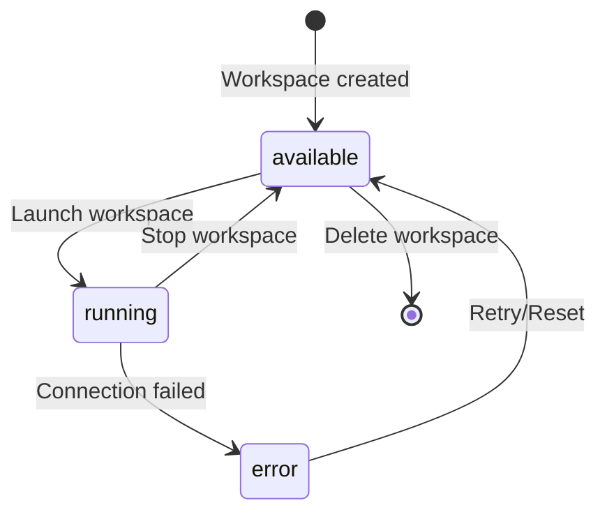

## Overview

Workspaces are isolated cloud desktop environments that provide secure access to various computing resources. NeoSC supports multiple workspace types including Linux desktops, Windows environments, secure browsers, and specialized admin panels.

## Workspace Types

NeoSC provides five pre-configured workspace types:

<CardGroup cols={2}>
  <Card title="Linux Desktop" icon="linux">
    Ubuntu 22.04 LTS with full desktop environment, ideal for development and general computing tasks.
  </Card>
  <Card title="Windows Desktop" icon="windows">
    Remote Desktop access via TSPlus HTML5, supporting Windows applications and SAP environments.
  </Card>
  <Card title="Secure Browser" icon="lock">
    Isolated browser environment with privacy and security controls for secure web access.
  </Card>
  <Card title="Admin Panel" icon="server">
    Infrastructure management panels like 1Panel for system administration tasks.
  </Card>
</CardGroup>

## Workspace Model

Each workspace contains the following properties:

```python backend/server.py
class Workspace(BaseModel):
    id: str                    # Unique workspace identifier
    name: str                  # Display name
    type: str                  # linux, windows, browser, dev, admin
    description: str           # Workspace description
    image_url: str            # Preview image URL
    status: str               # available, running, stopped, error
    cpu: str                  # CPU allocation (e.g., "2 vCPU")
    memory: str               # Memory allocation (e.g., "4 GB")
    storage: str              # Storage allocation (e.g., "50 GB")
    url: str                  # Connection URL
    connection_type: str      # html5, rdp, web, vnc, browser
    requires_netbird: bool    # NetBird VPN requirement
    icon: str                 # Icon identifier
```

## Connection Types

Workspaces support multiple connection protocols:

| Type | Description | Use Case |
|------|-------------|----------|
| `html5` | TSPlus HTML5 Desktop | SAP and enterprise applications |
| `rdp` | Remote Desktop Protocol | Windows desktops |
| `web` | Web Application | Admin panels and web apps |
| `vnc` | VNC Protocol | Linux desktops |
| `browser` | Secure Browser | Isolated web browsing |

## Listing Workspaces

Retrieve all available workspaces for the authenticated user:

<CodeGroup>
```bash cURL
curl -X GET "https://api.neosc.com/api/workspaces" \
  -H "Authorization: Bearer YOUR_TOKEN"
```

```javascript JavaScript
const response = await axios.get(`${API}/workspaces`, {
  headers: { Authorization: `Bearer ${token}` }
});

const workspaces = response.data;
```

```python Python
import requests

response = requests.get(
    "https://api.neosc.com/api/workspaces",
    headers={"Authorization": f"Bearer {token}"}
)

workspaces = response.json()
```
</CodeGroup>

### Response Example

```json
[
  {
    "id": "ws-sap-neogenesys",
    "name": "SAP Neogénesys",
    "type": "html5",
    "description": "TSPlus HTML5 Desktop para acceso a SAP",
    "status": "available",
    "cpu": "4 vCPU",
    "memory": "8 GB",
    "storage": "100 GB",
    "url": "http://tsplus.intranet.neosc/",
    "connection_type": "html5",
    "requires_netbird": true,
    "icon": "sap"
  }
]
```

## Launching Workspaces

Launch a workspace and create an active session:

<CodeGroup>
```bash cURL
curl -X POST "https://api.neosc.com/api/workspaces/{workspace_id}/launch" \
  -H "Authorization: Bearer YOUR_TOKEN"
```

```javascript JavaScript
const response = await axios.post(
  `${API}/workspaces/${workspaceId}/launch`,
  {},
  { headers: { Authorization: `Bearer ${token}` } }
);

const { session_id, stream_url, security } = response.data;
```

```python Python
response = requests.post(
    f"https://api.neosc.com/api/workspaces/{workspace_id}/launch",
    headers={"Authorization": f"Bearer {token}"}
)

data = response.json()
```
</CodeGroup>

### Launch Response

```json
{
  "session_id": "550e8400-e29b-41d4-a716-446655440000",
  "workspace": { /* workspace object */ },
  "stream_url": "/viewer/550e8400-e29b-41d4-a716-446655440000",
  "tunnel_status": "encrypted",
  "security": {
    "encrypted_tunnel": true,
    "identity_verified": true,
    "mfa_enforced": true,
    "session_recording": true,
    "no_open_ports": true
  }
}
```

<Note>
Launching a workspace automatically creates a new [Session](/features/sessions) and updates the workspace status to `running`.
</Note>

## Stopping Workspaces

Stop a running workspace and terminate the active session:

```javascript frontend/src/pages/WorkspacesPage.jsx
const handleStop = async (workspaceId) => {
  await axios.post(
    `${API}/workspaces/${workspaceId}/stop`,
    {},
    { headers: getAuthHeader() }
  );
  
  toast.success('Workspace detenido');
};
```

<CodeGroup>
```bash cURL
curl -X POST "https://api.neosc.com/api/workspaces/{workspace_id}/stop" \
  -H "Authorization: Bearer YOUR_TOKEN"
```

```json Response
{
  "message": "Workspace stopped successfully"
}
```
</CodeGroup>

## Creating Workspaces (Admin)

Administrators can create custom workspaces:

```javascript Example: Create Workspace
const workspaceData = {
  name: "Development Environment",
  type: "dev",
  description: "Node.js development container",
  url: "http://dev.internal.neosc:8080",
  connection_type: "web",
  requires_netbird: true,
  cpu: "2 vCPU",
  memory: "4 GB",
  storage: "50 GB",
  icon: "default"
};

await axios.post(`${API}/workspaces`, workspaceData, {
  headers: { Authorization: `Bearer ${token}` }
});
```

<Warning>
Workspace creation requires **admin role**. Regular users will receive a `403 Forbidden` error.
</Warning>

## Updating Workspaces (Admin)

Modify workspace configuration:

```bash backend/server.py:574
PUT /api/workspaces/{workspace_id}
```

```javascript Example: Update Workspace
const updates = {
  name: "Updated SAP Desktop",
  description: "New description",
  cpu: "8 vCPU",
  memory: "16 GB"
};

await axios.put(`${API}/workspaces/${workspaceId}`, updates, {
  headers: { Authorization: `Bearer ${token}` }
});
```

## Deleting Workspaces (Admin)

Remove a workspace permanently:

```bash backend/server.py:593
DELETE /api/workspaces/{workspace_id}
```

<Warning>
Deleting a workspace is permanent and cannot be undone. Active sessions will be terminated.
</Warning>

## Reset to Defaults (Admin)

Reset all workspaces to the default configuration:

```javascript frontend/src/pages/WorkspacesPage.jsx:213
const handleReset = async () => {
  await axios.post(`${API}/workspaces/reset`, {}, {
    headers: getAuthHeader()
  });
  
  toast.success('Workspaces reseteados');
};
```

## NetBird Integration

Workspaces with `requires_netbird: true` can only be accessed when the NetBird VPN client is active:

<Steps>
  <Step title="Install NetBird Client">
    Download and install the NetBird client on your local machine
  </Step>
  <Step title="Connect to Network">
    Authenticate and connect to your organization's NetBird network
  </Step>
  <Step title="Launch Workspace">
    Once connected, launch workspaces that require NetBird access
  </Step>
</Steps>

## Workspace Status Flow



## Best Practices

<AccordionGroup>
  <Accordion title="Resource Allocation">
    Choose CPU, memory, and storage based on your workload:
    - **Light browsing**: 1 vCPU, 2 GB RAM
    - **Office applications**: 2 vCPU, 4 GB RAM
    - **Development**: 4 vCPU, 8 GB RAM
    - **Heavy workloads**: 8+ vCPU, 16+ GB RAM
  </Accordion>
  
  <Accordion title="Security Considerations">
    - Always enable NetBird for internal resources
    - Use MFA for sensitive workspaces
    - Review audit logs regularly
    - Implement session recording for compliance
  </Accordion>
  
  <Accordion title="Connection Types">
    - Use HTML5 for legacy Windows applications
    - Choose VNC for Linux desktops
    - Use web type for cloud-native applications
    - Browser type for isolated web browsing
  </Accordion>
</AccordionGroup>

## Related Resources

<CardGroup cols={2}>
  <Card title="Sessions" icon="clock" href="/features/sessions">
    Manage active workspace sessions
  </Card>
  <Card title="Security Policies" icon="shield" href="/features/security-policies">
    Configure workspace access policies
  </Card>
  <Card title="Audit Logs" icon="list" href="/features/audit-logs">
    Track workspace usage and actions
  </Card>
  <Card title="Organizations" icon="building" href="/features/organizations">
    Multi-tenant workspace isolation
  </Card>
</CardGroup>