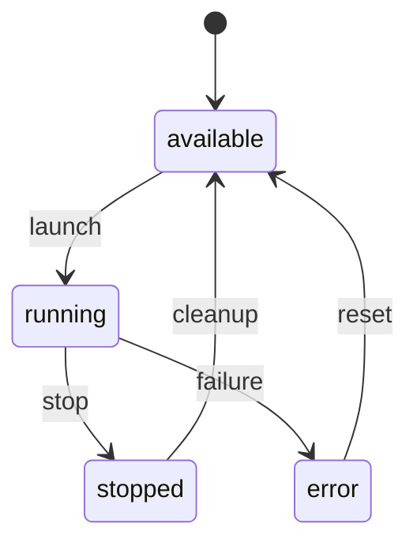

## Overview

NeoSC workspaces are pre-configured cloud desktop environments that users can launch on-demand. Admins can create, update, and manage workspace configurations including resource specifications, connection types, and security requirements.

## Workspace Model

Workspaces are defined with the following structure:

```python
# From backend/server.py:66-76
class Workspace(BaseModel):
    id: str
    name: str
    type: str  # linux, windows, browser, dev, admin, html5, rdp, web
    description: str
    image_url: str
    status: str = "available"  # available, running, stopped, error
    cpu: str = "2 vCPU"
    memory: str = "4 GB"
    storage: str = "50 GB"
```

Extended fields for connection configuration:
- `url`: Direct URL for web-based workspaces
- `connection_type`: `html5`, `rdp`, `vnc`, `web`, `browser`
- `requires_netbird`: Boolean for Zero Trust network requirement
- `icon`: Visual identifier (e.g., `sap`, `windows`, `linux`, `panel`)

## Default Workspace Types

NeoSC includes five pre-configured workspace types:

### 1. SAP Neogénesys (HTML5 Desktop)

```python
# From backend/server.py:447-460
{
    "id": "ws-sap-neogenesys",
    "name": "SAP Neogénesys",
    "type": "html5",
    "description": "TSPlus HTML5 Desktop para acceso a SAP. Requiere conexión NetBird activa.",
    "cpu": "4 vCPU",
    "memory": "8 GB",
    "storage": "100 GB",
    "url": "http://tsplus.intranet.neosc/",
    "connection_type": "html5",
    "requires_netbird": True,
    "icon": "sap"
}
```

<Note>
HTML5 workspaces use TSPlus for remote desktop streaming. NetBird provides encrypted WireGuard tunnel access to internal infrastructure.
</Note>

### 2. Remote Desktop (RDP)

```python
# From backend/server.py:462-475
{
    "id": "ws-remote-desktop",
    "name": "Remote Desktop",
    "type": "rdp",
    "description": "Escritorio remoto Windows via TSPlus HTML5. IP: 10.100.10.152",
    "cpu": "4 vCPU",
    "memory": "8 GB",
    "storage": "100 GB",
    "url": "http://10.100.10.152/",
    "connection_type": "html5",
    "requires_netbird": True
}
```

### 3. 1Panel Admin

```python
# From backend/server.py:477-490
{
    "id": "ws-1panel",
    "name": "1Panel Admin",
    "type": "web",
    "description": "Panel de administración de infraestructura 1Panel.",
    "cpu": "2 vCPU",
    "memory": "4 GB",
    "storage": "50 GB",
    "url": "http://neosc.panel.neogenesys:35090/infra",
    "connection_type": "web",
    "requires_netbird": True
}
```

### 4. Linux Desktop

```python
# From backend/server.py:492-505
{
    "id": "ws-linux-desktop",
    "name": "Linux Desktop",
    "type": "linux",
    "description": "Ubuntu 22.04 LTS con entorno de escritorio completo.",
    "cpu": "2 vCPU",
    "memory": "4 GB",
    "storage": "50 GB",
    "connection_type": "vnc",
    "requires_netbird": True
}
```

### 5. Secure Browser

```python
# From backend/server.py:507-520
{
    "id": "ws-secure-browser",
    "name": "Secure Browser",
    "type": "browser",
    "description": "Navegador aislado con controles de privacidad y seguridad.",
    "cpu": "1 vCPU",
    "memory": "2 GB",
    "storage": "10 GB",
    "connection_type": "browser",
    "requires_netbird": False
}
```

## Managing Workspaces

<Warning>
Workspace management endpoints require **admin** role. Regular users can only view and launch workspaces.
</Warning>

### Listing Workspaces

All authenticated users can retrieve available workspaces:

```bash
GET /api/workspaces
Authorization: Bearer <token>
```

Response:
```json
[
  {
    "id": "ws-sap-neogenesys",
    "name": "SAP Neogénesys",
    "type": "html5",
    "status": "available",
    "cpu": "4 vCPU",
    "memory": "8 GB",
    "storage": "100 GB",
    "url": "http://tsplus.intranet.neosc/",
    "requires_netbird": true
  }
]
```

### Creating Workspaces

<Steps>
  <Step title="Authenticate as admin">
    Ensure your user has `role: "admin"` in the user object.
  </Step>
  
  <Step title="Define workspace configuration">
    Prepare workspace specification:
    
    ```json
    {
      "name": "Development Environment",
      "type": "dev",
      "description": "VS Code Server with Docker support",
      "url": "https://dev.internal.company.com",
      "connection_type": "web",
      "requires_netbird": true,
      "cpu": "4 vCPU",
      "memory": "16 GB",
      "storage": "200 GB",
      "image_url": "https://example.com/dev-icon.png",
      "icon": "code"
    }
    ```
  </Step>
  
  <Step title="Create workspace">
    Send POST request to `/api/workspaces`:
    
    ```bash
    curl -X POST https://api.portal.kappa4.com/api/workspaces \
      -H "Authorization: Bearer <admin_token>" \
      -H "Content-Type: application/json" \
      -d @workspace.json
    ```
    
    Implementation reference: `backend/server.py:559-572`
  </Step>
  
  <Step title="Verify creation">
    The system generates a workspace ID (`ws-{uuid}`) and logs the action to audit logs.
  </Step>
</Steps>

### Updating Workspaces

Admins can modify workspace configurations:

```bash
PUT /api/workspaces/{workspace_id}
Authorization: Bearer <admin_token>
Content-Type: application/json

{
  "memory": "32 GB",
  "cpu": "8 vCPU",
  "description": "Updated description",
  "status": "available"
}
```

Only provided fields are updated (partial update). See `backend/server.py:574-591` for implementation.

### Deleting Workspaces

Remove workspaces permanently:

```bash
DELETE /api/workspaces/{workspace_id}
Authorization: Bearer <admin_token>
```

<Warning>
Deleting a workspace does not terminate active sessions. Disconnect sessions manually before deletion to prevent orphaned sessions.
</Warning>

### Resetting to Defaults

Restore default workspace configurations:

```bash
POST /api/workspaces/reset
Authorization: Bearer <admin_token>
```

This operation:
1. Deletes all existing workspaces
2. Re-creates the five default workspaces
3. Logs the reset action

See `backend/server.py:606-617` for implementation.

## Connection Types

NeoSC supports multiple workspace connection methods:

### HTML5 (TSPlus)

```json
{
  "connection_type": "html5",
  "url": "http://tsplus.intranet.neosc/",
  "requires_netbird": true
}
```

**Use case**: Remote desktop access to Windows and SAP environments via browser.

**Requirements**: Active NetBird tunnel for internal network access.

### Web Application

```json
{
  "connection_type": "web",
  "url": "http://neosc.panel.neogenesys:35090/infra",
  "requires_netbird": true
}
```

**Use case**: Web-based admin panels and internal applications.

**Requirements**: Direct HTTPS access or NetBird for internal URLs.

### VNC

```json
{
  "connection_type": "vnc",
  "url": "",
  "requires_netbird": true
}
```

**Use case**: Linux desktop environments.

<Note>
VNC integration requires VDI backend (Kasm/Guacamole) - planned for P0 implementation.
</Note>

### Secure Browser

```json
{
  "connection_type": "browser",
  "requires_netbird": false
}
```

**Use case**: Isolated browsing sessions without network dependencies.

## Resource Specifications

### CPU Configuration

Define virtual CPU allocation:

```json
{
  "cpu": "2 vCPU"  // Light workloads
  "cpu": "4 vCPU"  // Standard desktops
  "cpu": "8 vCPU"  // Heavy compute tasks
}
```

### Memory Allocation

```json
{
  "memory": "2 GB"   // Minimal (browser only)
  "memory": "4 GB"   // Standard
  "memory": "8 GB"   // Desktop environments
  "memory": "16 GB"  // Development workspaces
  "memory": "32 GB"  // High-performance
}
```

### Storage Capacity

```json
{
  "storage": "10 GB"   // Temporary sessions
  "storage": "50 GB"   // Standard
  "storage": "100 GB"  // Desktop environments
  "storage": "200 GB"  // Development with containers
}
```

<Note>
Resource specifications are currently labels for display purposes. Actual resource enforcement requires integration with container orchestration (Docker, Kubernetes) planned for future releases.
</Note>

## Workspace Status Management

Workspaces transition through four states:



### Status Values

| Status | Description |
|--------|-------------|
| `available` | Ready to launch, no active sessions |
| `running` | Currently in use by one or more users |
| `stopped` | Paused, can be resumed |
| `error` | Launch failure or runtime error |

### Status Transitions

**Launch workspace**:
```python
# backend/server.py:619-660
@api_router.post("/workspaces/{workspace_id}/launch")
# Updates status: available → running
await db.workspaces.update_one({"id": workspace_id}, {"$set": {"status": "running"}})
```

**Stop workspace**:
```python
# backend/server.py:662-683
@api_router.post("/workspaces/{workspace_id}/stop")
# Updates status: running → available
await db.workspaces.update_one({"id": workspace_id}, {"$set": {"status": "available"}})
```

## NetBird Integration

Workspaces requiring internal network access use NetBird Zero Trust tunnels:

```json
{
  "requires_netbird": true,
  "url": "http://tsplus.intranet.neosc/"
}
```

### How NetBird Works

1. **WireGuard Tunnel**: Creates encrypted peer-to-peer connections
2. **Zero Trust**: No open firewall ports, all traffic authenticated
3. **Internal Access**: Enables connections to `10.x.x.x` networks and `.intranet` domains

<Warning>
Users must have NetBird client installed and authenticated before launching workspaces with `requires_netbird: true`. Connection attempts will fail without active tunnel.
</Warning>

See NetBird configuration docs for setup details.

## Workspace Images

Define visual representation:

```json
{
  "image_url": "https://images.unsplash.com/photo-1551288049-bebda4e38f71?w=400",
  "icon": "sap"
}
```

### Supported Icons

- `sap` - SAP application
- `windows` - Windows desktop
- `linux` - Linux environments
- `panel` - Admin panels
- `browser` - Web browser
- `code` - Development environments
- `default` - Generic workspace

## Best Practices

<CardGroup cols={2}>
  <Card title="Right-size Resources" icon="gauge">
    Allocate CPU, memory, and storage based on actual usage patterns. Monitor resource utilization and adjust specifications accordingly.
  </Card>
  
  <Card title="Standardize Naming" icon="tag">
    Use consistent naming conventions for workspace types (e.g., "[Environment] - [Purpose]") to improve discoverability.
  </Card>
  
  <Card title="Document Requirements" icon="book">
    Include NetBird requirements and access URLs in workspace descriptions to help users prepare for connections.
  </Card>
  
  <Card title="Test Before Deployment" icon="flask">
    Verify workspace URLs and connection types in staging before creating production workspaces.
  </Card>
</CardGroup>

## Troubleshooting

### Workspace Stuck in Running State

If workspace status doesn't reset after stopping:

```bash
PUT /api/workspaces/{workspace_id}
Content-Type: application/json

{"status": "available"}
```

### Connection URL Not Working

Verify:
1. URL is accessible from backend container network
2. NetBird tunnel is active (for `requires_netbird: true`)
3. Internal DNS resolution works (test with `curl` from backend)
4. No firewall blocking connections

### Default Workspaces Not Loading

The system auto-initializes default workspaces on first `GET /api/workspaces` request. If workspaces don't appear:

1. Check MongoDB connectivity
2. Verify `DEFAULT_WORKSPACES` array in `backend/server.py:445-521`
3. Use `POST /api/workspaces/reset` to force re-initialization (admin only)