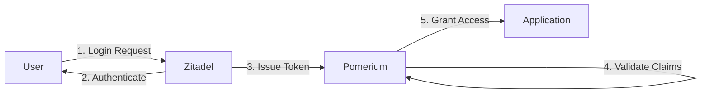

## Overview

NeoSC implements a **Zero Trust** security architecture where no user or service is trusted by default, regardless of network location. Every request is authenticated and authorized based on identity, context, and policy.

## Zero Trust Principles

### Core Tenets

<CardGroup cols={2}>
  <Card title="Never Trust, Always Verify" icon="shield-check">
    Every request must be authenticated and authorized, even from internal networks
  </Card>
  <Card title="Least Privilege Access" icon="key">
    Users and services receive minimum permissions required for their role
  </Card>
  <Card title="Assume Breach" icon="triangle-exclamation">
    Architecture designed assuming attackers may already be inside the network
  </Card>
  <Card title="Identity-Centric Security" icon="user-shield">
    Security decisions based on verified identity, not network location
  </Card>
</CardGroup>

## Architecture Components

### Identity Provider (Zitadel)

**Role**: Source of truth for user identity and authentication

- Issues OIDC tokens with user claims and roles
- Manages user lifecycle and multi-factor authentication
- Provides centralized identity management
- Supports JIT (Just-In-Time) provisioning for demo sessions



**Key Claims in Token**:

```json
{
  "sub": "user-id-12345",
  "email": "user@company.com",
  "name": "John Doe",
  "urn:zitadel:iam:org:project:{PROJECT_ID}:roles": {
    "admin": {},
    "neosc": {}
  }
}
```

### Zero Trust Proxy (Pomerium)

**Role**: Policy enforcement point for all application access

Pomerium sits between users and applications, enforcing access policies:

1. **Intercepts** all requests to protected applications
2. **Validates** session cookies and OIDC tokens
3. **Enforces** access policies based on identity and context
4. **Injects** identity headers to upstream applications
5. **Logs** all access attempts for audit

```yaml
# Example Pomerium policy
policy:
  - from: https://portal.kappa4.com
    to: http://frontend:3000
    
    # Only authenticated users
    allow_any_authenticated_user: false
    
    # Require specific roles
    allowed_idp_claims:
      urn:zitadel:iam:org:project:roles:
        - admin
        - neosc
        - user
    
    # Inject identity headers
    pass_identity_headers: true
    set_request_headers:
      X-Pomerium-Email: "${pomerium.email}"
      X-Pomerium-User: "${pomerium.user}"
      X-Pomerium-Groups: "${pomerium.groups}"
```

### Protected Applications

**Role**: Trust identity headers from Pomerium, no direct authentication

Applications never see user credentials - they only receive verified identity information via HTTP headers:

```python
# Backend FastAPI example
async def verify_pomerium_headers(
    x_pomerium_email: Optional[str] = Header(None),
    x_pomerium_user: Optional[str] = Header(None)
):
    if not x_pomerium_email:
        raise HTTPException(status_code=401, detail="Unauthorized")
    
    return {
        "email": x_pomerium_email,
        "user_id": x_pomerium_user
    }

@app.get("/api/user/profile")
async def get_profile(user: dict = Depends(verify_pomerium_headers)):
    # user is already authenticated by Pomerium
    return await fetch_user_profile(user["email"])
```

## Authentication Flow

### Initial Access Request

```
User                 Pomerium              Zitadel            Application
 │                       │                     │                   │
 │─────GET /────────────▶│                     │                   │
 │                       │ [No valid session]  │                   │
 │                       │                     │                   │
 │◀──302 to gate────────│                     │                   │
 │                       │                     │                   │
 │─GET /oauth2/sign_in──▶│                     │                   │
 │                       │                     │                   │
 │                       │──302 to Zitadel────▶│                   │
 │◀──────────────────────────────302──────────│                   │
 │                       │                     │                   │
 │──Login Form──────────────────────────────▶│                   │
 │◀─────────────────────────────────────────│                   │
 │                       │                     │                   │
 │──Credentials─────────────────────────────▶│                   │
 │                       │                     │ [Validate]        │
 │                       │◀──code─────────────│                   │
 │◀──302 callback───────│                     │                   │
 │                       │                     │                   │
 │─GET /callback?code───▶│                     │                   │
 │                       │──Exchange code─────▶│                   │
 │                       │◀──tokens────────────│                   │
 │                       │ [Create session]    │                   │
 │                       │ [Set cookie]        │                   │
 │◀──302 to app─────────│                     │                   │
 │                       │                     │                   │
 │─GET / [+ cookie]─────▶│ [Validate session]  │                   │
 │                       │ [Check policy]      │                   │
 │                       │ [Inject headers]    │                   │
 │                       │─────────────────────────────────────────▶│
 │                       │                     │                   │
 │◀──────────────────────────────────────────────────200 OK───────│
```

### Session Cookie

Pomerium sets a session cookie `_pomerium` on domain `.kappa4.com`:

- **Domain**: `.kappa4.com` (valid for all subdomains)
- **Duration**: 8 hours
- **Flags**: `HttpOnly`, `Secure`, `SameSite=Lax`
- **Contents**: Encrypted session token

This provides **Single Sign-On (SSO)** across all NeoSC services:

```
portal.kappa4.com      ← Same session cookie
api.portal.kappa4.com  ← Same session cookie  
admin.portal.kappa4.com ← Same session cookie
workspace.portal.kappa4.com ← Same session cookie
```

## Access Control Policies

### Role-Based Access Control (RBAC)

Pomerium enforces access based on roles defined in Zitadel:

| Role | Access Level | Routes |
|------|--------------|--------|
| `admin` | Full access | All routes including admin panel |
| `neosc` | Standard user | Portal, API, workspace viewer |
| `user` | Basic access | Portal, API (read-only) |
| `demo-user` | Temporary | Workspace viewer only |

### Policy Examples

<Tabs>
  <Tab title="Portal Access">
    ```yaml
    # portal.kappa4.com - Standard users
    - from: https://portal.kappa4.com
      to: http://frontend:3000
      
      allowed_idp_claims:
        urn:zitadel:iam:org:project:roles:
          - admin
          - neosc
          - user
      
      pass_identity_headers: true
      cors_allow_preflight: true
      allow_websockets: true
    ```
  </Tab>
  <Tab title="Admin Panel">
    ```yaml
    # admin.portal.kappa4.com - Admin only
    - from: https://admin.portal.kappa4.com
      to: http://backend:8001
      
      allowed_idp_claims:
        urn:zitadel:iam:org:project:roles:
          - admin
      
      pass_identity_headers: true
      timeout: 30s
    ```
  </Tab>
  <Tab title="Workspace Viewer">
    ```yaml
    # workspace.portal.kappa4.com - Active demo session required
    - from: https://workspace.portal.kappa4.com
      to: http://kasm-proxy:6900
      
      # Require demo session claim
      allowed_idp_claims:
        neosc:demo_session_id:
          - "*"  # Any valid session ID
      
      set_request_headers:
        X-Session-ID: "${pomerium.claims.neosc:demo_session_id}"
        X-User-Email: "${pomerium.email}"
        X-Workspace-Type: "${pomerium.claims.neosc:workspace_type}"
      
      allow_websockets: true
      allow_spdy: true
      timeout: 0s  # No timeout for streaming
    ```
  </Tab>
</Tabs>

### Context-Aware Policies

Pomerium can enforce policies based on request context:

```yaml
# Advanced policy with context
policy:
  - from: https://portal.kappa4.com
    to: http://frontend:3000
    
    policy:
      # Check token hasn't expired
      - allow:
          and:
            - claim/neosc:demo_expires_at:
                is: after_now
      
      # Rate limiting per user
      - allow:
          and:
            - user:
                is: "{{ .User.Email }}"
          rate_limit:
            requests_per_second: 10
            burst: 20
      
      # Time-based access (business hours only)
      - allow:
          and:
            - day_of_week:
                is_in: ["monday", "tuesday", "wednesday", "thursday", "friday"]
            - time:
                after: "08:00:00"
                before: "20:00:00"
                timezone: "America/Mexico_City"
```

## Network Segmentation

### Docker Networks

Services are isolated using Docker networks:

```yaml
networks:
  proxy:
    # Public network - Pomerium communicates with external world
    driver: bridge
  
  internal:
    # Private network - services NOT exposed to external
    driver: bridge
    internal: true  # No external connectivity
```

**Network Topology**:

```
┌─────────────────────────────────────────────────────────┐
│                    External Network                      │
└───────────────────────┬─────────────────────────────────┘
                        │
           ┌────────────▼──────────────┐
           │      Pomerium             │ ◄── On both networks
           │  (proxy + internal)       │
           └────────────┬──────────────┘
                        │
┌───────────────────────▼──────────────────────────────────┐
│              Internal Network (isolated)                  │
│   ┌──────────┐   ┌──────────┐   ┌──────────┐           │
│   │ Frontend │   │ Backend  │   │ MongoDB  │           │
│   │  :3000   │   │  :8001   │   │  :27017  │           │
│   └──────────┘   └──────────┘   └──────────┘           │
│   NO EXTERNAL ACCESS - Only via Pomerium                 │
└──────────────────────────────────────────────────────────┘
```

### Key Security Features

<Steps>
  <Step title="No Direct Access">
    Frontend, backend, and database are **never** exposed directly to the internet. All access goes through Pomerium.
  </Step>
  <Step title="Mutual TLS">
    Pomerium can enforce mutual TLS (mTLS) for service-to-service communication within the internal network.
  </Step>
  <Step title="Service Isolation">
    Each service runs in its own container with resource limits and no unnecessary privileges.
  </Step>
</Steps>

## Just-In-Time (JIT) Access

For demo sessions, NeoSC implements JIT provisioning:

### JIT Workflow

1. User requests demo access
2. Zitadel Action creates **temporary role** (e.g., `demo-user-12345`)
3. Role expires after 30 minutes
4. Custom claims added to token:
   ```json
   {
     "neosc:demo_session_id": "demo-1234567890-abc",
     "neosc:demo_expires_at": "2026-03-05T12:30:00Z",
     "neosc:workspace_type": "linux",
     "neosc:max_duration": 1800
   }
   ```
5. Backend provisions isolated workspace
6. After expiration, role is automatically revoked

### Automatic Cleanup

```python
# Backend schedules cleanup when session expires
async def schedule_session_cleanup(session_id: str, expires_at: datetime):
    delay = (expires_at - datetime.now(timezone.utc)).total_seconds()
    await asyncio.sleep(delay)
    
    # Cleanup resources
    await delete_demo_container(session_id)
    await revoke_netbird_peer(session_id)
    await remove_jit_role(session_id)
    
    # Update session status
    await db.demo_sessions.update_one(
        {"session_id": session_id},
        {"$set": {"status": "expired", "ended_at": datetime.now(timezone.utc)}}
    )
```

## Security Boundaries

### Trust Boundaries

```
╔═══════════════════════════════════════════════════════╗
║             UNTRUSTED (Internet)                      ║
╚════════════════════╦══════════════════════════════════╝
                     ║
                     ▼
        ┌─────────────────────────┐
        │   Pomerium              │  ◄── Trust boundary enforced here
        │   (Authentication +     │
        │    Authorization)       │
        └─────────────────────────┘
                     ║
                     ▼
╔════════════════════════════════════════════════════════╗
║         TRUSTED (Internal Network)                     ║
║  Applications trust Pomerium-injected headers          ║
╚════════════════════════════════════════════════════════╝
```

### Security Assumptions

<Warning>
  **Critical Security Requirement**: Applications in the internal network MUST only accept requests from Pomerium, never directly from users.
</Warning>

- Backend validates `X-Pomerium-*` headers are present
- If `TRUST_POMERIUM_HEADERS=false`, backend performs additional JWT validation
- Network policies prevent direct access to internal services

## Monitoring & Audit

### Access Logs

Pomerium logs all access decisions:

```json
{
  "level": "info",
  "timestamp": "2026-03-05T10:15:30Z",
  "user": "user@company.com",
  "email": "user@company.com",
  "method": "GET",
  "path": "/api/workspace/12345",
  "host": "api.portal.kappa4.com",
  "decision": "allow",
  "reason": "matched_policy",
  "duration_ms": 45,
  "status": 200
}
```

### Audit Trail

All authentication and authorization events are logged for compliance:

- User login/logout
- Policy evaluation results  
- Access grants and denials
- Session creation and expiration
- Role assignments and revocations

### Metrics

Key metrics to monitor:

```promql
# Authentication success rate
rate(pomerium_authenticate_success_total[5m]) /
rate(pomerium_authenticate_total[5m])

# Authorization denials (potential attacks)
rate(pomerium_authorize_deny_total[5m])

# Active sessions
pomerium_active_sessions

# Average policy evaluation time
rate(pomerium_policy_evaluation_duration_seconds_sum[5m]) /
rate(pomerium_policy_evaluation_duration_seconds_count[5m])
```

## Best Practices

<CardGroup cols={2}>
  <Card title="Minimize Token Lifetime" icon="clock">
    Keep access tokens short-lived (30 min) and refresh tokens long-lived for better security.
  </Card>
  <Card title="Principle of Least Privilege" icon="user-lock">
    Grant users minimum roles required. Use JIT provisioning for temporary access.
  </Card>
  <Card title="Defense in Depth" icon="layer-group">
    Layer multiple security controls: network isolation, authentication, authorization, and audit.
  </Card>
  <Card title="Regular Audits" icon="clipboard-check">
    Review access logs and policies regularly to detect anomalies and refine controls.
  </Card>
</CardGroup>

## Next Steps

<CardGroup cols={2}>
  <Card title="Pomerium Configuration" icon="gear" href="/infrastructure/pomerium">
    Deep dive into Pomerium policies and routes
  </Card>
  <Card title="NetBird Security" icon="network-wired" href="/infrastructure/netbird">
    Learn about network-level isolation with NetBird
  </Card>
</CardGroup>
